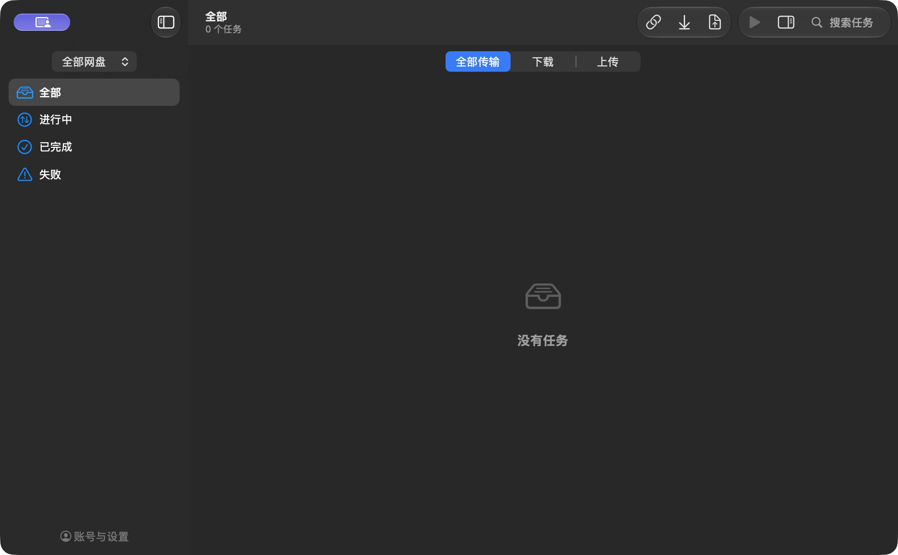

# Ferry Plus

[](https://github.com/yjcdon/ferry-plus/releases/latest)

[](LICENSE)

Ferry Plus 是一款简洁的 macOS 原生百度网盘、夸克网盘文件传输工具，基于 [Ferry](https://github.com/yiquncode/BaiduPCS-Swift)，使用 Swift 和 SwiftUI 开发，专为 Apple Silicon Mac 构建。

[下载 Ferry Plus 3.1](https://github.com/yjcdon/ferry-plus/releases/tag/v3.1) · [更新记录](CHANGELOG.md)

支持两家网盘的本地文件／文件夹上传、分享链接及账号内文件下载。两个账号可同时登录，上传和下载统一管理，传输速度受网盘服务和账号权限限制。



## 当前功能

以下为当前开发版本的功能，已发布的安装包仍为 3.1。

- **双网盘上传**：选择文件或文件夹，也可拖入上传窗口或网盘目录；支持分片、正常暂停续传、保留两份和跳过同名文件。
- **内容一致性校验**：上传后检查云端文件；下载保留后台内容校验和已有校验记录。
- **百度安全覆盖**：新内容校验后发布，独立保留旧版本；夸克本版提供保留两份和跳过。
- **网盘文件管理**：在主窗口浏览百度和夸克文件，按名称、修改日期或大小排序；支持新建目录、上传、下载及移入网盘回收站。
- **双网盘下载**：支持百度、夸克分享链接和账号内文件下载，保留所选目录结构；在主窗口切换网盘，选择文件后下载。
- **双网盘登录**：通过百度、夸克的官方网页完成登录，分别保存账号状态；账号菜单同步显示账号名，并可单独退出。
- **统一任务列表**：按网盘、状态和文件名筛选；批量操作遵守当前可见范围。
- **断点恢复**：支持暂停、继续、退出恢复和地址刷新；分享转存保存各批回执，完成后按设置清理本任务目录。
- **独立设置**：两家分别设置转存目录、完成清理和单文件连接数，共用全局同时下载文件数。
- **本机保存凭据**：登录凭据存入 macOS Keychain，应用直接访问网盘服务。

3.0 的双网盘上传／下载、完整内容校验、网盘删除已有真实 App 验证；实现与验证范围见 [3.0 功能清单](docs/v3/features.md)、[架构设计](docs/v3/architecture.md) 和 [任务清单](docs/v3/tasks.md)。

## 3.1 优化版

3.1 已完成19项代码整理和技术审查，减少任务列表重复筛选、上传检查点读取、百度安全覆盖回读和校验记录重复写入，统一界面状态、通知及构建打包流程。沿用3.0的登录、数据格式与主要交互。

实际3.1 App已通过百度、夸克分片上传和独立下载的完整内容核对，以及百度覆盖新旧版本回读、网盘删除、筛选、源文件重选和导出取消／重开等界面回归。Release提供实测App的ZIP与SHA文件，发布包只包含应用程序，不包含本机登录凭据或用户数据。范围和结果见 [3.1任务清单](docs/v3.1/tasks.md)、[实施记录](docs/v3.1/implementation.md) 和 [技术审查](docs/v3.1/review.md)。

## 使用边界

- 极端异常自动恢复和夸克安全覆盖延期。少数写请求丢失回执或会话过期后，任务可能停在“结果待核对”，应用保留记录，不会盲目重复提交。
- 取消上传不承诺立即清除服务端未完成分片；移除任务记录不会删除本地源文件或已上传的云端文件。

## 系统要求

- macOS 14 或更高版本
- Apple Silicon（arm64）Mac

## 安装

### ZIP 安装

从 [3.1 Release](https://github.com/yjcdon/ferry-plus/releases/tag/v3.1) 下载 `Ferry-Plus-3.1-arm64.zip`，解压后把 `Ferry Plus.app` 拖到“应用程序”文件夹即可，无需 DMG。发布页同时提供 SHA-256 校验文件。

### Homebrew 安装

安装定义直接维护在本仓库的 `Casks/ferry-plus.rb` 中。首次使用先添加安装源，再安装：

```sh
brew tap yjcdon/ferry-plus https://github.com/yjcdon/ferry-plus
brew install --cask yjcdon/ferry-plus/ferry-plus
```

如果新版 Homebrew 提示安装源尚未信任，先明确授权这个软件，再重新安装：

```sh
brew trust --cask yjcdon/ferry-plus/ferry-plus
```

已通过 ZIP 手动安装相同版本的用户，可在安装命令中加 `--adopt`，让 Homebrew 接管内容完全相同的现有 App；不需要先卸载。版本或内容不同时，Homebrew 会拒绝接管。

后续升级：

```sh
brew update
brew upgrade --cask yjcdon/ferry-plus/ferry-plus
```

Homebrew 与 ZIP 使用相同的 Release 文件，仅支持 Apple Silicon、macOS 14 及以上。Homebrew 安装同样受 macOS 首次启动安全检查约束。普通卸载只移除 App，保留本机账号和任务数据。

维护安装源时，每次发布新版需同步更新 `Casks/ferry-plus.rb` 的 `version` 和 ZIP 的 `sha256`；`livecheck` 用于检测 GitHub 最新 Release，不会自动修改安装定义。

可与原版 Ferry 共存；两者的登录凭据、设置及任务数据独立。

Ferry Plus 没有经过 Apple 公证。第一次打开时，如果 macOS 阻止运行，打开“系统设置 → 隐私与安全性”，在“安全性”中点击“仍要打开”。首次访问保存的凭据或切换签名身份时，系统可能要求允许访问钥匙串。

## 本机构建

本机构建使用 Command Line Tools，不需要安装完整 Xcode。当前已验证的环境为 Swift 6.4、macOS 26.5 SDK；完整 Xcode 也可用于工程构建。

```sh
bash Scripts/build-app.sh
open ".build/Ferry Plus.app"
```

脚本输出可直接运行的 `.app`。SDK 可通过 `FERRY_MACOS_SDK` 指定，具体构建和登录验证记录见 [登录说明](docs/login.md)。

默认构建 Debug，交付使用 `FERRY_BUILD_CONFIGURATION=release bash Scripts/build-app.sh`，为包与应用启用优化；两种模式复用同一签名身份和 App 路径。

Release App 构建完成后，运行 `bash Scripts/package-app.sh` 生成 `.build/dist/` 下的 arm64 ZIP 和 SHA-256 文件。打包前核对应用标识、架构和签名；该命令打包已有 App，不改变构建模式。默认解压为可直接运行的 `Ferry Plus.app`；可选 App 路径会保留该 App 的名称。

本机构建自动复用唯一有效的代码签名证书，保持重建后的钥匙串授权。存在多个证书时，通过 `FERRY_CODESIGN_IDENTITY` 指定证书名称或 SHA-1；无证书时使用临时签名并提示重建授权限制，也可显式指定 `-` 使用临时签名。无需把本机证书信息写入仓库。

本机构建与 Release 工作流均生成非沙盒 App，使用相同的应用标识及用户数据目录，保持登录、设置和任务存储位置一致。

现有 Swift 包测试同样可使用 Command Line Tools 执行：

```sh
bash Scripts/test-packages.sh
```

## 项目结构

```
BaiduPCS-Swift/          Ferry Plus.app：SwiftUI 界面、Keychain、下载目录权限、应用生命周期
Packages/FerryKit/
├── FerryCore            任务流程：上传／下载队列、流式校验、任务存储与设置
├── BaiduKit             百度协议：凭据、分享、转存、网盘操作、下载链接
├── QuarkKit             夸克登录、文件、分享、转存、上传与下载接口
└── DownloadKit          通用分片下载：分片、并发、断点续传、进度持久化
Scripts/                本机 .app 构建、ZIP 打包与包测试
docs/                   功能、架构、任务和验证记录
```

## 致谢

本项目基于 [yiquncode/BaiduPCS-Swift（Ferry）](https://github.com/yiquncode/BaiduPCS-Swift)。百度网盘接口的用法参考了 [BaiduPCS-Go](https://github.com/qjfoidnh/BaiduPCS-Go)。

## 许可证

[Apache License 2.0](LICENSE)
