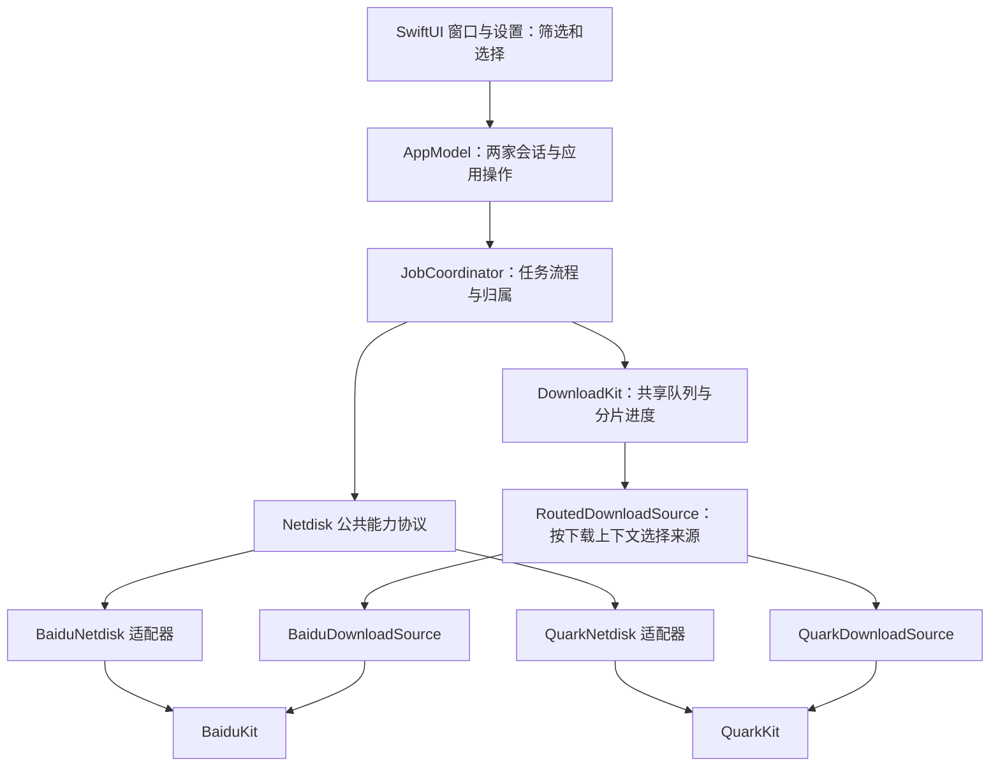
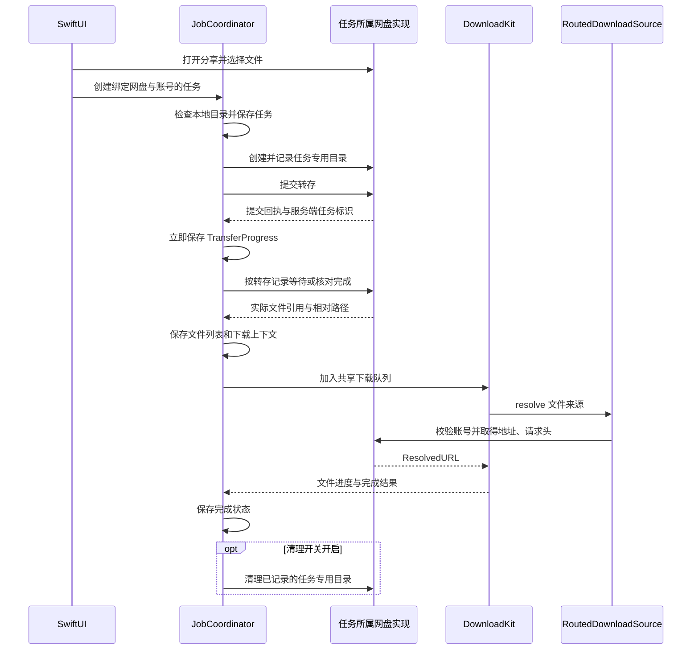

# Ferry Plus 架构设计

## 1. 结论与设计输入

采用轻量策略方案：公共协议描述下载所需的网盘能力，百度、夸克各有一个适配实现；统一任务调度按任务绑定的网盘和账号选择实现，共用现有 DownloadKit。

产品范围以 [新增功能清单](features.md) 的 F-01～F-29 为准。目标是保留 Ferry 的原生体验，一次性交付百度、夸克两家网盘下载能力，仅支持 arm64、macOS 14 及以上；仓库暂时移除介绍网站。

网盘来源只有百度和夸克；“分享链接”和“账号内文件”是两种任务来源方式。“全部网盘”是界面筛选范围，任务始终属于一家网盘及其具体账号。

## 2. 当前代码事实

| 位置 | 当前职责与限制 |
| --- | --- |
| [Package.swift](../Packages/FerryKit/Package.swift) | 已有 BaiduKit、DownloadKit、FerryCore；FerryCore 依赖前两者 |
| [Netdisk.swift](../Packages/FerryKit/Sources/FerryCore/Netdisk.swift) | 已有网盘协议，但参数使用 BaiduKit 的分享会话、文件等类型 |
| [DownloadTypes.swift](../Packages/FerryKit/Sources/DownloadKit/DownloadTypes.swift) | DownloadSource.resolve 返回地址及请求头，DownloadRequest.context 是应用提供的持久化数据 |
| [BaiduDownloadSource.swift](../Packages/FerryKit/Sources/FerryCore/BaiduDownloadSource.swift) | 百度地址解析策略，context 当前为网盘路径的 UTF-8 数据 |
| [Job.swift](../Packages/FerryKit/Sources/FerryCore/Job.swift) | 任务来源持有百度类型，归属为 accountUK；文件定位主要是 remotePath |
| [JobCoordinator.swift](../Packages/FerryKit/Sources/FerryCore/JobCoordinator.swift) | 统一转存、下载、清理和持久化，但只持有一个当前 netdisk、accountUK，并直接构造百度下载 context |
| [AppModel.swift](../BaiduPCS-Swift/AppModel.swift) | 只有一套当前账号、凭据、客户端与下载来源；启动时恢复任务并校验登录 |
| [MainView.swift](../BaiduPCS-Swift/MainView.swift)、[SidebarView.swift](../BaiduPCS-Swift/SidebarView.swift) | 主窗口持有分类、搜索、选中项；列表按分类及搜索过滤，选中项操作取可见交集。侧边栏显示单一百度账号，分类数量及底部速度从完整任务集合计算 |
| [MainView.swift](../BaiduPCS-Swift/MainView.swift)、[BaiduPCS_SwiftApp.swift](../BaiduPCS-Swift/BaiduPCS_SwiftApp.swift) | PauseResumeAllButton 和 FerryCommands 的“全部暂停／继续”当前使用完整任务集合；选中项菜单通过 JobSelection 获得主窗口范围，需要同步调整两类入口 |
| [CredentialStore.swift](../BaiduPCS-Swift/CredentialStore.swift) | 使用应用 bundle 标识划分钥匙串空间，百度登录使用 baidu-login 条目 |
| [JobStore.swift](../Packages/FerryKit/Sources/FerryCore/JobStore.swift) | JSON 任务列表及 Application Support/Ferry 数据目录 |
| [DownloadRecord.swift](../Packages/FerryKit/Sources/DownloadKit/DownloadRecord.swift) | 分片状态按文件下载 ID 保存；临时文件位于目标文件同目录，名称由下载 ID 推导 |
| [FileTransfer.swift](../Packages/FerryKit/Sources/DownloadKit/FileTransfer.swift) | 已处理 Range、Content-Range、大小、退避和地址失效；同文件的并发刷新合并处理 |
| [FerrySettings.swift](../Packages/FerryKit/Sources/FerryCore/FerrySettings.swift) | 下载并发为全局设置，包含百度会员预设与总连接数约束 |
| website 目录、README、.gitignore | website/public/index.html 是 Ferry 静态介绍页，包含网站专用图片和字体；website/wrangler.jsonc 仅配置静态资源发布，README 有原网站徽章，.gitignore 有 .wrangler/ 忽略项；当前应用源码及工程未引用网站目录 |
| [.github/workflows/release.yml](../.github/workflows/release.yml) | 当前唯一工作流用于构建、签名和发布 Mac 应用，没有网站部署步骤；与介绍网站移除分别处理 |

因此，现有策略入口可以复用，主要改造集中在公共模型、来源路由和账号归属；新建 QuarkKit 处理夸克协议。

## 3. 模块与依赖

### 3.1 目标结构

公共模型和协议继续放在 FerryCore。两个适配器也位于 FerryCore 的独立目录，调用各自协议包；不增加独立的通用模型包。

图中的 DownloadKit → RoutedDownloadSource 表示运行时调用注入的 DownloadSource 协议，不表示 DownloadKit 反向依赖 FerryCore。

| 模块 | 目标职责 | 状态所有权 |
| --- | --- | --- |
| 应用层 | 账号入口、官方登录页窗口、文件树、任务展示、系统菜单、目录授权、通知、闲置防休眠 | AppModel 持有两家会话；MainView 持有网盘筛选、分类、搜索及选中项；新建窗口持有本次来源与账号；会话通过明确接口供调度使用 |
| FerryCore 公共部分 | 网盘标识、公共文件及任务模型、Netdisk 协议、任务编排、来源路由、兼容读取 | 持久任务、任务归属、转存目录归属、创建时的目标位置 |
| FerryCore 适配部分 | 公共操作与两家客户端模型之间的转换；各自下载来源实现 | 有限生命周期的分享会话及协议专属操作上下文 |
| BaiduKit | 保留百度接口、签名、Cookie 及原始响应解析 | 百度协议内部状态 |
| QuarkKit | 网页会话导入、账号校验、文件、分享、转存任务、下载地址及 Cookie 更新 | 夸克协议内部状态 |
| DownloadKit | HTTP 文件传输、共享并发限制、分片、临时文件、进度和恢复 | 文件下载状态、分片位移、已取得的短期下载地址 |

目标包依赖为 FerryCore → BaiduKit、QuarkKit、DownloadKit；BaiduKit 和 QuarkKit 保持独立，DownloadKit 不识别网盘类型。界面、公共任务模型和公共调度使用中立类型，不传递 BaiduKit.ShareSession 等协议专属类型。

### 3.2 策略选择边界

- 网盘来源采用有限枚举：baidu 表示百度，quark 表示夸克。
- AppModel 为两家各维护一个活跃会话，通过显式分支组装适配器与下载来源。
- JobCoordinator 在操作开始时根据任务来源和账号取得对应实现，不读取主窗口筛选或文件浏览窗口选择作为执行依据。
- RoutedDownloadSource 读取持久化下载上下文，选择对应账号客户端生成 ResolvedURL；继续复用现有 resolve 及失效刷新机制，不保留独立百度下载入口。
- 登录保留各自界面与流程，普通文件传输继续使用共同引擎。

策略表达为 Swift 协议和两个明确实现。文件定位差异通过适配器转换，不在每个调度步骤散布网盘判断。

### 3.3 界面筛选、账号展示与新建上下文

沿用 MainView 的本地状态及已有菜单上下文传递方式，增加网盘条件。列表是统一任务集合的派生结果，不为两家维护独立的任务列表副本或调度器。

| 状态／派生值 | 业务含义与所有者 | 使用规则 |
| --- | --- | --- |
| providerFilter | MainView 的网盘筛选，类型为可选 Provider | 未指定值表示“全部网盘”，初始使用该值；baidu 为百度、quark 为夸克；不写入 Job 或下载上下文 |
| category、searchText | MainView 的状态分类和搜索词 | 在当前网盘范围内继续过滤；切换网盘保留这两个条件 |
| selection | MainView 的已选任务 ID 集合 | 筛选条件或任务集合变化后与当前列表 ID 取交集；移除已隐藏的选择，详情和选中项操作使用同一结果 |
| providerJobs | 按网盘过滤后的任务 | 用于侧边栏各状态分类数量，包含该网盘不同历史账号的任务，不受搜索影响 |
| visibleJobs | 网盘、分类及搜索共同过滤后的任务 | 用于列表、标题数量和列表级批量操作；表示全部匹配项，包含尚未滚动到的行 |
| AccountSummary | AppModel 发布的各家账号名称、身份和登录状态 | 底部账号区按筛选展示；任务详情读取 Job 的绑定账号与名称快照，不用当前登录账号覆盖 |
| 新建任务上下文 | 添加窗口持有明确 Provider 和本次 AccountKey | 分享来源由解析结果确定；账号文件入口从筛选取得默认来源或先选择来源，打开后不随主窗口筛选改变 |

数据顺序为：JobCoordinator 完整任务集合 → providerJobs → 按 category 过滤 → 按 searchText 过滤 → visibleJobs。底部统计直接汇总完整任务集合，显示“全部网盘”、已下载／总大小、速度及文件完成数，统计弹层补充进度和预计剩余时间；准备中的任务注明总量尚未确定。完成文件数复用任务增量统计，避免每次进度刷新遍历全部文件。全局下载并发与通知同样不受筛选影响。

SidebarView 顶部使用“全部网盘／百度网盘／夸克网盘”下拉菜单。标题在全部网盘时为分类名，在单一网盘时为“网盘名称 · 分类名”；副标题为 visibleJobs 数量。行来源图标、悬停提示和辅助功能名称均由 Job 的 Provider 决定。

底部账号区在单一网盘时读取该网盘 AccountSummary，显示网盘、账号名及登录状态；未登录或失效时提供该网盘的登录入口。在全部网盘时显示“账号与登录”。账号菜单直接按网盘分组，首行展示“网盘 · 账号名”，其下显示该网盘操作，不嵌套子菜单；正常登录仅显示退出，失效显示重新登录，夸克校验失败提供重试。分组之间及设置前使用分隔线，单一网盘筛选只显示该网盘分组。所有登录、退出与换号操作显式携带 Provider；筛选变化仅更新视图，不建立或撤销会话。

### 3.4 批量操作范围与命令传递

| 入口 | 输入范围 | 执行方式 |
| --- | --- | --- |
| PauseResumeAllButton | MainView 传入 visibleJobs | 沿用暂停优先、其次继续的按钮逻辑；按实际可执行目标数生成提示，无目标禁用 |
| FerryCommands 列表级操作 | 通过主任务窗口的 focusedSceneValue 取得当前列表上下文 | 菜单用“暂停当前列表／继续当前列表”文案；与工具栏共用候选任务判断，无活动主任务窗口时禁用 |
| 详情、选中项菜单及快捷键 | selection 与 visibleJobs 的交集 | 复用 JobSelection 和 JobActionsMenu；主窗口处理原生全选命令，仅覆盖 visibleJobs；点选列表转移键盘焦点，文本框保留文字全选 |
| 右键菜单 | 右键已选中行时使用当前可见选中项；未选中行时只使用该行 | 确定目标后使用相同动作规则，避免旧选择影响另一行 |
| 移除确认 | 发起时的任务 ID、移除方式、按网盘的任务数及远端目录清理计划 | 对话框固定目标和清理选择；按各家设置分别说明将清理的目录数，确认后复核任务、账号及目录身份，不因筛选或设置变化扩大范围 |

窗口上下文同时携带有效的 providerFilter、visibleJobs 和选中项。providerFilter 未指定表示全部网盘；整个窗口上下文缺失表示没有可操作的列表，这两种情况必须区分。菜单的账号文件入口复用当前主窗口默认来源；从其他窗口发起时先打开主窗口，再使用该主窗口上下文确定默认来源，新主窗口初始为全部网盘。

AppModel 继续通过现有 jobs(in:allowing:) 等窄入口统一动作可用性；派生条件同时用于按钮禁用、目标数和执行名单。暂停仅针对下载阶段的可暂停任务；本地暂停、查看和移除不要求登录，需要网盘访问的继续或重试检查任务 AccountKey，缺少对应会话时提供登录原账号入口。移除涉及远端清理时仍按任务归属检查会话，无法清理则保留远端目录；返回结果携带网盘、所属账号、目录位置及原因，在移除任务后仍可向用户说明。

动作发起时固定目标 ID；执行时按最新任务状态复核，逐任务调用 Coordinator。某项失败展示对应原因，其他可执行项继续。Coordinator 只接收明确任务 ID，按任务归属选择网盘策略，不感知界面筛选。工具栏和应用菜单不再自行读取完整任务集合作为操作范围。

这部分属于界面状态与命令传递，不增加新的策略层；轻量策略只用于百度和夸克能力适配。

## 4. 公共契约与数据设计

下列名称表示设计职责，具体声明在实现时沿用现有命名风格。

### 4.1 关键模型

| 模型 | 关键内容及业务含义 | 使用规则 |
| --- | --- | --- |
| Provider | 网盘来源：baidu 表示百度，quark 表示夸克 | 仅这两个值用于账号、任务、设置及下载上下文；“全部网盘”只由界面筛选表达 |
| AccountKey | provider：网盘；accountID：该网盘稳定账号标识 | 百度 UK 转为字符串，夸克使用实际稳定用户标识；昵称不作身份 |
| AccountSummary | 账号身份、展示名称和登录状态 | 界面读取；不包含 Cookie、签名材料 |
| RemoteReference | 带种类的远端文件定位信息；百度保留路径及所需文件 ID，夸克保留 fid，即文件或目录 ID | 路径用于展示及布局时，与协议定位字段分开；不把夸克 ID 伪装成路径 |
| RemoteEntry | 远端定位、名称、文件或目录类型、大小、修改时间、相对路径 | 文件树和任务调度使用；目录大小未知时不伪造完整大小 |
| ShareLink | 网盘来源、规范化网址、分享标识、可选提取码 | 文案提取与链接类型校验由对应实现负责 |
| ShareHandle | 来源及本次打开分享的临时会话句柄 | Cookie、stoken、share_fid_token 等分享凭据保留在适配器会话内；任务恢复时重新打开分享 |
| TransferDirectory | 任务 ID、AccountKey、实际远端目录定位、展示路径 | 创建成功后立即记录，是远端清理的唯一授权范围 |
| TransferProgress | Job 内的转存记录：兼容单次回执；夸克分批记录相对目录、条目 ID、实际目标引用、提交意图、服务端任务标识及完成状态 | 每批提交前保存意图，收到回执即保存，再等待结果；同步完成接口可直接记录完成，状态不明时保留核对依据 |
| TransferManifestEntry | 相对路径 relativePath、文件字节数 size；保存在 Job.transferManifest 中 | 提交前持久化所选文件清单，不含分享令牌；用于核对目标完整性，完成转存后不依赖原分享仍有效。nil 表示旧记录尚无清单，空数组表示已确认没有文件 |
| Job | 原有任务数据，加 provider（百度／夸克）、AccountKey、创建时账号名称快照、TransferProgress、格式版本及目标位置；source 区分分享链接与账号内文件并保存选中条目 | 创建后来源、账号及目标位置固定；名称仅供展示，旧任务无名称时显示网盘与稳定账号 ID。完成自动清理读取该网盘当前设置，主动移除使用操作发起时确定的清理计划 |
| JobFile | 保留原文件下载 ID、相对路径、大小、本地结果；增加远端引用和可获得的内容版本信息 | 同一个文件下载 ID 关联其原有分片和临时文件 |
| DownloadContext | 格式版本、AccountKey、远端引用及可获得的内容身份 | 序列化进现有 DownloadRequest.context；不含登录凭据、分享临时令牌或下载直链 |

公共模型中的有限远端引用分支只负责表达身份。JobCoordinator 传递引用，不据此拼装百度或夸克请求。

### 4.2 Netdisk 能力契约

| 能力 | 输入与输出 | 异常及一致性要求 |
| --- | --- | --- |
| 打开分享 | ShareLink、提取码 → ShareHandle 和分享摘要 | 提取码错误、分享失效、需登录分别返回，不能当作空目录 |
| 列分享目录 | ShareHandle、目录引用 → 完整一层 RemoteEntry 列表 | 适配器处理分页；中途失败不得当完整列表提交 |
| 列账号内文件目录 | 百度或夸克账号绑定会话、目录引用 → 完整一层条目 | 根目录由网盘实现表达，调用方不假定所有网盘都以路径定位 |
| 准备转存目录 | 任务 ID、配置路径 → TransferDirectory | 找到配置父目录并创建任务子目录；记录返回的真实定位，不使用任意路径删除作为补偿 |
| 提交及恢复转存 | 可选 ShareHandle、选择条目、TransferDirectory、原 TransferProgress、进度回调 → 最终 TransferProgress | 单一入口处理提交及有界查询；计划、目标目录、提交意图、回执及完成分别回调，由 Coordinator 立即持久化。已有回执不重提，只有明确未提交的批次需要分享会话 |
| 递归列文件 | 选中条目或转存目录 → 文件列表和相对保存路径 | 保留目录结构；确认选中目录为空后才允许零文件完成 |
| 清理任务目录 | 已记录的 TransferDirectory → 清理结果 | 校验来源、账号和任务目录身份；直接从账号内下载的源文件保持原样 |

当前实现中 ShareLink、ShareHandle 分别使用 `DiskShareLink`、`DiskShareSession` 命名。`prepareTransfer` 在提交意图落盘前恢复短期文件令牌；窗口与调度在流程结束时显式 `releaseShare`，不以任意固定缓存数量淘汰仍在使用的会话。任务格式版本为 1，同时写入明确网盘字段；未知版本或来源不一致时拒绝加载并保留原始数据。

`submitTransfer` 接收原转存记录和异步 `onProgress` 回调，避免另设提交、轮询两条恢复入口。写盘失败发生在 POST 前的提交意图阶段时恢复内存前态；已收到的服务端回执保留在内存，不回退成“未提交”。

文件下载地址仍由 DownloadSource.resolve 提供，输出沿用 ResolvedURL，包括地址和请求头。两家登录交互由各自官方页面处理，应用复用网页容器与 Cookie 监听；各自客户端负责会话校验，不强行塞进同一个登录协议。

### 4.3 会话与账号一致性

1. 每家一个会话槽位，包含 AccountKey、客户端、适配器、登录状态和会话版本。两家分别更新。
2. 创建任务记录明确 AccountKey；本次打开的文件树同样绑定该账号。打开文件树后换号，原选择不能提交到新账号。
3. 转存、取链接、清理开始前检查账号，异步返回后再校验会话版本，防止换号后旧响应写入新会话。
4. 每次操作使用开始时取得的会话快照。取消轮询只停止本地等待，不代表服务端已经撤销转存。
5. 退出登录清除对应本地凭据及分享会话，任务保留。已经建立且仍有效的文件连接沿用现有执行行为；后续需要获取地址、转存或清理时必须重新通过账号校验。

替换账号或网络会话时，立即 revoke 旧 API 客户端并取消旧准备任务，避免其在内部等待结束后继续发起写请求。任务恢复不等待另一家网盘完成网络鉴权；后台校验的迟到结果必须复核版本后才发布。
6. 退出或切换其中一家不使另一家的会话失效，不改变另一家的任务。

原 AccountCheckedSource 的前后校验职责保留并泛化到 AccountKey；RoutedDownloadSource 负责来源选择。迁移后旧的单一全局账号判断和百度专属 context 构造入口统一替换，避免两条判断路径并存。

## 5. 核心流程

### 5.1 夸克官方网页登录与会话建立

WKWebView 加载 https://pan.quark.cn/ → 用户在官方页面完成短信或扫码等登录 → 监听私有 WKHTTPCookieStore → 导入夸克域会话 → QuarkKit 校验账号与根目录访问能力 → 保存钥匙串 → 发布夸克登录状态并关闭登录窗口。

- 复用百度已有的 WebLoginSession 与 WebViewContainer，按网盘选择官方页面和凭据提取规则；页面使用非持久化数据存储，关闭窗口后不额外保存浏览器登录环境。
- 验证码、二维码、过期刷新及安全验证由官方页面处理；应用不再生成二维码、轮询扫码状态或换取扫码票据，不读取账号输入框或密码。
- 仅提取夸克域的有效 Cookie；__pus、__kps、__uid 就绪后提交候选凭据，再验证实际网盘能力。后续接口补全或更新 __puus 等字段时，写回同一钥匙串条目。
- 登录完成以账号身份及实际网盘鉴权结果为准，不仅检查某个 Cookie 名是否存在。
- 页面加载失败可重新加载，账号校验失败可重试；取消或关闭窗口停止 Cookie 监听与校验任务，取消后的响应不能保存登录。不把完整 Cookie 写入日志。

### 5.2 分享转存与下载

手动粘贴与剪贴板检测共用来源识别。ShareLink 的 Provider 由百度或夸克链接确定，不从 providerFilter 赋值；添加窗口显示识别出的网盘，并使用该网盘账号完成登录检查及文件选择。

分享会话过期可重新打开原分享，已确认转存完成的任务直接使用记录中的对应账号内文件引用。中断重试优先使用已保存的服务端任务标识查询结果；任务仍在执行时继续等待，确认完成后再列文件。服务端已接受但回执尚未落盘、或服务端已无法查询时，结果标为待确认，结合任务目录和所选条目核对；无法证明完成则保留失败原因，不以目录非空代替成功，也不自动重复提交。

提交前按所选文件的相对路径与大小建立清单并持久保存；选中目录时仅读取对应源子树，不扫描无关分享目录。回执完成后，目标目录的递归文件列表按已存清单核对，恢复无需重新打开原分享。缺少文件、大小不符或出现非所选文件时保留目录与回执，停止下载及自动清理；重试重新核对列表，不重新提交已经完成的转存。旧记录没有清单时，原分享仍有效则重建清单后核对原结果；无法获取清单则明确结果待确认，保留已有回执和目录。

夸克跨层级部分选择按分享中的父目录分批：例如同时选择 `A/说明.txt` 与 `B/说明.txt`，在本任务专用目录内分别建立 `A`、`B` 后转存。勾选整个目录时去除已被该目录包含的子项，避免重复提交。每批保留独立回执；恢复时已完成批次跳过、已有回执批次继续查询、明确未提交批次继续提交，已记意图却没有回执的批次停止并提示结果待确认。已记录的目标 fid 必须仍对应任务根目录内的相对路径。

创建结果返回任务 ID 和 Provider。新任务不符合当前筛选时，主窗口保留筛选并显示带网盘名称的成功提示；“查看任务”将 providerFilter 切到任务网盘、category 切到全部、清空 searchText，再选中该任务。该定位动作仅改变视图。

转存进行中移除任务时，停止本地等待并处理已提交的远端任务；若无法确认服务端是否仍在写入目录，保留该目录并提示清理未完成，不把本地取消当作远端操作已经撤销。

远端清理有两个触发点：全部下载成功后按当前网盘设置自动清理；用户主动移除时按本次移除计划清理。两者都校验任务目录及账号归属，混合操作逐任务选择对应会话；清理失败独立报告，不改变已完成下载的结果。

### 5.3 百度／夸克账号内文件下载

从“从我的网盘下载”入口取得默认来源：主窗口已筛选百度或夸克时使用该来源；筛选全部网盘时先展示百度／夸克选择。入口不以全局“是否已登录”禁用，未登录时打开所选网盘登录窗口。

确定 Provider → 校验该网盘登录并绑定文件浏览会话 AccountKey → 列目录 → 用户选择条目 → 使用同一 AccountKey 创建任务 → 适配器递归生成文件和相对路径 → 进入同一个下载队列。

打开文件选择窗口后，主窗口切换筛选不改变窗口内来源；同一家换号按 4.3 的会话校验处理，旧账号选择不能提交到新账号。创建结果同样使用 5.2 的任务定位规则。

分享和账号文件树的目录加载及重试由视图任务持有；收起目录、切换文件树或关闭窗口时取消请求。节点只发布当前请求的结果，取消或被替代的迟到响应不修改子项、错误和新请求的加载状态；已有缓存不重新触发首次全选。

该流程不创建转存目录，不调用远端清理。清理条件由任务来源和记录中的任务目录共同决定。

### 5.4 地址刷新与内容一致性

- ResolvedURL 的请求头由所属网盘实现生成，含所需 Cookie、Referer、User-Agent 等；不把当前界面账号的 Cookie 覆盖到全部请求。
- 继续复用 LinkProvider 对同文件并发刷新合并的行为，地址失效后调用原来源重新解析。
- 新地址必须仍指向同一远端文件；有文件版本、修改时间、大小或可用校验值时用于核对，分片响应继续校验 Content-Range 和长度。
- 远端内容变化或不再支持原来的续传方式时，任务保留原因并要求重新下载，不拼接不同文件内容。
- 完整内容校验值只在可取得且含义明确时使用，不把大小一致描述为已验证完整哈希。

### 5.5 启动、暂停与退出

沿用任务阶段与文件下载状态两层表达：任务阶段为准备／转存、下载、完成、失败，暂停只作用于下载阶段；等待、速度和剩余时间是运行时展示状态。

启动先装载两家账号状态及任务，完成格式迁移，再恢复引擎。未登录或账号不匹配的任务保留进度并提示；暂停标记保持；未确认完成的转存按现有恢复原则进入准备失败，用户重试后核对远端结果。

正常退出沿用 shutdown 保存顺序。网络重试采用现有有界退避；重试耗尽后保留分片并支持手动继续。应用实际传输期间持有闲置防休眠活动，全部暂停、结束或退出时释放，用户主动休眠不被阻止。

## 6. 设置、资源与存储

### 6.1 设置与全局资源上限

| 设置层次 | 内容 | 生效规则 |
| --- | --- | --- |
| 全局 | 默认下载目录、同时下载文件数、剪贴板检测、代理 | 继续通过统一入口更新；保存目录仅对新任务生效 |
| 按网盘 | 转存父目录、完成清理开关、单文件连接数、适用预设 | 两家分别保存；百度预设不作为夸克会员规则；任务创建时固定转存位置，清理开关沿用该网盘当前设置 |
| 按任务 | AccountKey、保存目录、实际任务转存目录 | 创建后固定，重试与恢复不改绑 |

只有一个 DownloadEngine，同时下载文件数按全局统计。为支持单文件连接数按网盘设置，可在下载请求中增加可选连接数覆盖值，旧请求缺失时沿用原配置。

有效单文件连接数取该网盘设置与全局允许上限的较小值，继续维持“全局同时下载文件数 × 最大有效单文件连接数不超过既有总连接上限”的约束。该计算统一执行；网络重试不重新创建绕过上限的并行引擎。

运行时改变同时下载文件数或连接数预算时，先取消正在执行的文件传输并保存分片，待旧连接收尾后按最新预算重新排队；手动暂停的标记保持不变。重排期间不启动新 worker，快速连续设置采用最后一次配置，避免旧连接和新预算叠加突破资源上限。仅改变其他下载参数时直接更新，不重启文件传输。

代理更新同时作用于两家 API 客户端和引擎会话，不清除账号归属。设置值校验沿用现有合法范围，夸克默认连接数先用单连接，按真实接口验证结果确定适用预设。

### 6.2 数据隔离和兼容

- Ferry Plus 使用独立 bundle 标识、Application Support/Ferry Plus 和钥匙串 service，避免与本机原版 Ferry 同时写一个任务列表或共享可变凭据。
- 旧格式兼容针对提供给 Ferry Plus 的任务与状态文件。首次运行不自动读取、移动或覆盖原版 Ferry 的实际数据；本次不隐含增加原版应用数据导入流程。
- 任务保持现有 JSON 列表容器；新增版本与网盘字段。明确识别为旧版百度结构时，补充 baidu 来源，并将 accountUK 转换为百度 AccountKey。
- 旧版未知账号任务保留未确认状态。账号内文件任务必须登录并确认原账号，不能绑定到任意当前账号。
- 下载记录中旧 context 是路径字节。仅在可由文件下载 ID 关联到明确的旧百度任务时，转换为新 DownloadContext；保留下载 ID、目标位置、临时文件和分片位移。
- 如需改变 DownloadKit 的状态装载接口，仅增加恢复时转换应用 context 的窄接口；引擎不解析网盘字段。无法确认的记录保留并显示恢复问题。
- 首次写入新格式前保留可恢复的旧数据副本，继续原子写入。升级不重置任务或分片；新旧两版应用不同时使用同一份升级数据。

### 6.3 凭据与诊断

账号身份、非敏感配置和任务信息分别保存；Cookie、服务票据和代理密码进入钥匙串或短期内存，不进入任务 JSON。分享网址及用户填写的提取码属于恢复任务所需的用户数据；额外的分享会话 Cookie、stoken、文件令牌在需要时重新获取。

日志记录网盘、任务 ID、步骤和脱敏错误。包含登录凭据或签名参数的完整响应、下载直链不写入任务历史。清理失败和通知未授权等次要问题不覆盖真实下载结果。

### 6.4 CPU、内存与磁盘占用

- 最终产物使用 arm64 Release 优化构建，核对整个 `.app` 和可执行文件实际大小，与本机原 Ferry 比较；允许适度增加，明显增长必须定位到具体内容。
- 空闲时停止下载进度定时器；暂停、完成及退出释放防休眠活动和无用网络工作。测量空闲与下载期间的 CPU，不能用单次瞬时读数替代稳定区间。
- 正式下载流式写盘，完成校验按块读取；文件大小增加不应要求将整个文件读入内存。重复打开、关闭文件树和登录页后检查工作集是否稳定，关闭网页登录需释放其观察、任务和相关会话。
- 内存测量分别记录主进程 RSS 和可取得的物理 footprint；若存在属于本 App 的 WebKit 辅助进程，应纳入说明。没有原 Ferry 同等场景的运行数据时，不声称两者内存或 CPU 已相同。
- 磁盘分别记录 App、应用支持数据与缓存。用户主动保留的历史、暂停分片、迁移备份及下载文件有明确用途；完成、取消后应清理本次不再需要的状态及临时文件。开发编译产物不计入交付 App 体积。

## 7. 功能技术映射

本表使用功能清单原编号；“验证”均为实现后的要求，不表示已完成。

| 编号与功能 | 行为、负责模块与状态 | 数据／接口 | 异常边界与验证 |
| --- | --- | --- | --- |
| F-01 应用身份与 arm64 交付 | 应用工程、打包流程及存储入口统一标识 | bundle、产物架构、数据目录、许可 | 验证 arm64 可运行、原版数据独立、macOS 14 API 可用性 |
| F-02 双网盘账号入口 | AppModel 两家会话，侧边栏按筛选展示单一账号或两家菜单 | providerFilter、AccountSummary、AccountKey | 验证未登录／失效／换号；筛选不改变登录，底部当前账号不覆盖任务账号 |
| F-03 夸克官方网页登录 | 共用官方页容器与 Cookie 监听，QuarkKit 校验会话 | WKWebView、私有 Cookie 存储、账号及根目录接口 | 验证官方页面登录、重新加载、取消及校验重试；页面支持的方式以现场为准 |
| F-04 登录保持与账号切换 | 会话版本校验，凭据按网盘更新 | 账号校验、Keychain | 换号中旧响应不覆盖新账号，另一家不受影响 |
| F-05 双网盘分享识别 | 两家解析器确定来源，创建后提供任务定位 | ShareLink、提取码、任务 ID | 筛选夸克时粘贴百度链接仍创建百度任务；错误码和失效链接分别验证 |
| F-06 双网盘剪贴板检测 | 应用激活回调及去重状态 | 剪贴板版本、来源和分享标识 | 同内容不重复，两个网盘不误判为同分享 |
| F-07 夸克分享文件选择 | 适配器处理分页，文件树管理选择 | ShareHandle、RemoteEntry | 分页／递归失败不漏项提交，换号后原选择失效 |
| F-08 双网盘账号文件浏览 | 单一网盘筛选提供默认来源，全部网盘先选来源；文件树绑定账号 | Provider、AccountKey、目录引用、RemoteEntry | 未登录可进入登录，换筛选不改变已打开文件树；验证多层目录及相对路径，无源文件写入 |
| F-09 单任务保存位置 | 沿用目录选择和授权管理 | DownloadFolder、书签 | 无权限可重新选择，新默认目录不移动旧任务 |
| F-10 夸克分享转存 | Coordinator 保存提交回执，QuarkNetdisk 按记录等待异步结果 | TransferDirectory、TransferProgress | 验证提交后退出、查询中断及回执未落盘；确认完成再下载，结果不明不重复提交 |
| F-11 转存内容清理 | Coordinator 分别处理完成自动清理与主动移除清理 | 任务目录引用、分网盘设置、移除清理计划 | 混合确认说明两家目录范围；只删归属明确的目录，失败提示位置且不改下载结果 |
| F-12 混合任务列表 | MainView 派生筛选结果，SidebarView 展示范围与数量 | providerFilter、category、searchText、providerJobs、visibleJobs | 验证三种网盘筛选与分类／搜索组合、标题数及分类数；原始集合和后台执行不变 |
| F-13 任务详情与批量操作 | 列表级与选中项入口共享范围和动作规则，确认固定目标 | visibleJobs、selection、目标 ID、JobFile、链接及位置 | 隐藏选中项清除，右键未选中行不误操作旧选择；确认不扩展任务，各项按归属执行 |
| F-14 任务归属隔离 | AccountCheckedSource 泛化，调度前后校验；视图仅展示 | AccountKey、会话版本 | 切筛选不改绑或暂停；同号不同网盘、同网盘换号及并发换号均不串用 |
| F-15 夸克下载地址与刷新 | QuarkDownloadSource、RoutedDownloadSource | DownloadContext → ResolvedURL | 实测请求头、过期刷新、无权限停止重试 |
| F-16 双网盘并发下载 | 一个引擎、全局调度及连接数覆盖 | 全局配置、按来源连接数 | 混合负载不超过全局上限，夸克不套百度预设 |
| F-17 暂停继续与重试 | AppModel 筛选当前范围内可执行目标，复用引擎与任务操作 | 任务 ID、阶段、暂停标记、失败步骤 | 工具栏／菜单范围一致，目标数正确；隐藏任务不受影响，转存不计入暂停，完成文件不重下 |
| F-18 任务持久化与启动恢复 | JobStore、引擎状态、启动顺序 | 来源、账号、文件引用、分片 | 强退与重开可恢复，转存未完成不误标成功 |
| F-19 续传与完成校验 | 复用 FileTransfer 并核对远端内容 | Range、长度、内容版本及可用校验值 | 断网、换地址、内容变化、不支持 Range 分别验证 |
| F-20 通用与分网盘设置 | FerrySettings 拆分通用值和来源值 | 网盘键控配置、任务快照 | 修改一家设置不覆盖另一家，转存目标不追随改动 |
| F-21 双网盘代理 | 应用统一网络配置，更新两家客户端及引擎 | ProxySettings、代理密码 | 系统／SOCKS5 及代理切换下两家流程可运行 |
| F-22 分网盘异常展示 | 两家适配器转换公共错误，界面给出动作 | 错误分类、网盘、步骤、原始错误码 | 认证／限流／网络／文件系统错误不混淆 |
| F-23 凭据独立保存 | Keychain 条目按来源隔离 | 凭据、更新 Cookie、代理密码 | 退出一家不清另一家，任务文件与日志无会话秘密 |
| F-24 旧格式百度数据兼容 | 公共解码和 context 迁移入口 | 旧任务、accountUK、路径 context | 旧样本 ID 和分片不变，未知数据不按夸克或当前账号解释 |
| F-25 原生窗口与应用生命周期 | 沿用 SwiftUI、AppDelegate，主窗口向菜单提供操作上下文 | focusedSceneValue、窗口状态、启动及 shutdown | 无活动列表窗口时批量菜单禁用，菜单／快捷键范围一致；关窗口继续、Dock 重开、退出保存 |
| F-26 下载期间闲置防休眠 | 应用层观察实际活动并持有系统活动令牌 | 实际传输数量、系统活动生命周期 | 暂停／结束释放，主动睡眠后可恢复 |
| F-27 本地文件处理 | 复用 LocalPath、目录授权和废纸篓操作 | 相对路径、实际落盘 URL、临时文件 | 同名不覆盖，删除范围准确，失败可 Finder 定位 |
| F-28 下载统计与完成通知 | 列表统计由窗口筛选派生，Activity 全局汇总及通知按完整集合 | visibleJobs、文件快照、任务来源与完成事件 | 底部速度标注全部网盘且覆盖隐藏任务；列表数符合搜索，通知包含来源，拒绝通知权限仍可完成 |
| F-29 暂时移除介绍网站 | 移除 website 及网站专用入口，保留应用发布链路 | 静态站点目录、Wrangler 配置、README 徽章、.wrangler 忽略项 | 核对移除范围及全仓引用；应用源码、图标、README 截图、许可及 Release 工作流完整 |

## 8. 夸克接口依据与待验证内容

默认技术路径为本机直接调用夸克网盘接口，Swift 原生实现客户端。参考项目只作为协议及行为依据，不作为下载运行时依赖。

| 目的 | 已发现接口／参考实现 | 当前证据与验证要求 |
| --- | --- | --- |
| 官方登录页 | https://pan.quark.cn/ | 页面含官方登录组件；实际短信／扫码方式及完整登录需人工完成后验证 |
| 导入并校验会话 | WKHTTPCookieStore、pan.quark.cn/account/info | 需验证网页 Cookie、稳定账号身份及后续会话补全；空账号数据不能视为登录成功 |
| 夸克账号内文件目录 | /1/clouddrive/file/sort | 未登录请求返回 401；需验证分页、目录 ID 和权限 |
| 分享访问 | /1/clouddrive/share/sharepage/token、detail | 需验证提取码、分页及选中文件令牌 |
| 转存 | /1/clouddrive/share/sharepage/save、/1/clouddrive/task | 需验证实际成功状态、超时和再次核对方式 |
| 下载与清理 | /1/clouddrive/file/download、/1/clouddrive/file/delete | 需验证请求域、必要参数、请求头、Range、直链刷新及任务目录清理 |

不同参考实现使用 drive-pc.quark.cn、drive.quark.cn 或 pan.quark.cn 的不同接口域。具体路由、方法、响应字段和业务码以账号实测为准，集中放在 QuarkKit，不在公共层复制。

参考资料：

- [Quark Downloader Pro 客户端实现](https://github.com/OP404OP/quarkdownloaderpro/blob/main/src-tauri/src/quark_client.rs)：二维码、Cookie、分享、转存及下载接口。
- [Quark Downloader Pro 业务流程](https://github.com/OP404OP/quarkdownloaderpro/blob/main/frontend/src/features/download/DownloadManager.tsx)：转存与下载编排。Ferry Plus 按本方案在下载完成后清理，保留恢复所需源文件。
- [OpenList 夸克实现](https://github.com/OpenListTeam/OpenList/blob/main/drivers/quark_uc/util.go)：地址解析、请求头及 Cookie 更新参考。
- [夸克官方 Skill](https://github.com/quark-clouddrive/quarkclouddrive_offical)：另有授权及下载路径，本文不混用其授权会话和网页接口凭据。

## 9. 影响、迁移和验证

### 9.1 必须覆盖的影响面

公共类型迁移影响 Job、JobCoordinator、AccountCheckedSource、文件树、分享输入、百度／夸克账号文件窗口、设置、账号展示、任务详情和下载 context 构造。迁移时先完成公共协议和两个适配实现，再迁移全部调用方，确认后清理旧入口；保证共同状态只有一个所有者。

界面范围改造覆盖 MainView、SidebarView、PauseResumeAllButton、JobSelection、JobActionsMenu 和 FerryCommands。同步调整工具栏、菜单、快捷键、右键及详情入口；StatusBar 保持全局汇总并明确标签。复用已有动作判断，禁止菜单绕过窗口范围直接操作完整任务集合。

原有百度接口及错误含义继续保留，百度专属登录和会员提示仍在百度上下文展示。更换应用标识时一并调整数据路径和打包标识，避免仅改显示名导致原版数据混写。

F-29 的移除范围为整个 website 目录、README 的网站徽章，以及 .gitignore 中仅服务网站的 .wrangler/ 项。网站图片位于 website/public，应用图标位于 Assets.xcassets，README 截图位于 .github，后两者保留。现有 Release 工作流没有网站步骤，继续承担 Mac 应用发布；README 介绍与下载链接改为 Ferry Plus 及本仓库 Releases，保留上游来源和许可说明。实际移除时先移动到废纸篓，再检查工程、文档与脚本引用；此项只处理仓库文件，不操作原作者的线上网站或托管服务。

### 9.2 验证方式

| 验证层次 | 必要证据 |
| --- | --- |
| 当前文档交付 | 功能编号完整映射，链接有效，文档与现状和已确定范围一致；文档修改不执行编译 |
| 实现后的静态与构建检查 | 检查公共模型及调度不依赖百度类型；使用现有测试和受影响 Swift 包构建；生成 arm64 应用并检查系统 API 可用性；新增测试类需用户另行要求 |
| 真实接口验证 | 经用户确认的账号和样例文件，记录脱敏状态码、文件大小、转存目录、Range 响应及刷新结果；不把能取得二维码令牌作为全链路通过 |
| 数据兼容 | 使用旧任务和分片样本，在独立副本中验证解码、账号归属及续传，确认 ID 和分片位移保持 |
| 界面范围验收 | 组合三种网盘筛选、四种状态分类、空／有结果／无结果搜索与多选；核对分类数、列表数、账号区和批量目标；验证隐藏选择、右键行、菜单焦点缺失、确认期间状态变化及跨网盘新增任务定位 |
| 网站移除验收 | 全仓检查网站目录、部署配置及入口引用，核对 README 本地图片与 Releases 链接；确认 Xcode／Swift 包及 Release 工作流仍无网站依赖 |
| 人工业务验收 | 按 features.md 第 7 节逐项验证，重点覆盖混合下载、筛选时后台继续、换号、网络中断、退出恢复、清理及废纸篓范围 |

关键不确定性是夸克会话建立和维护、下载权限与 Range 行为、地址过期刷新、异步转存核对。实施先打通最小夸克客户端、登录界面、账号校验及凭据保存；用户完成官方登录后，自动验证入口复用同一客户端和保存的会话，验证目录、分享、转存及下载接口，再推进正式适配和应用编排。后续功能完成后继续复用有效会话进行回归，避免维护另一套登录或复制 Cookie 的验证流程。

首次登录、重新登录、验证码和必要的系统凭据访问确认由用户处理；接口与任务流程尽量自动验证，界面观感及需要人工触发的场景保留人工验收。完整任务依赖见 [实施任务清单](tasks.md)。所有功能仍按同一次交付验收。
