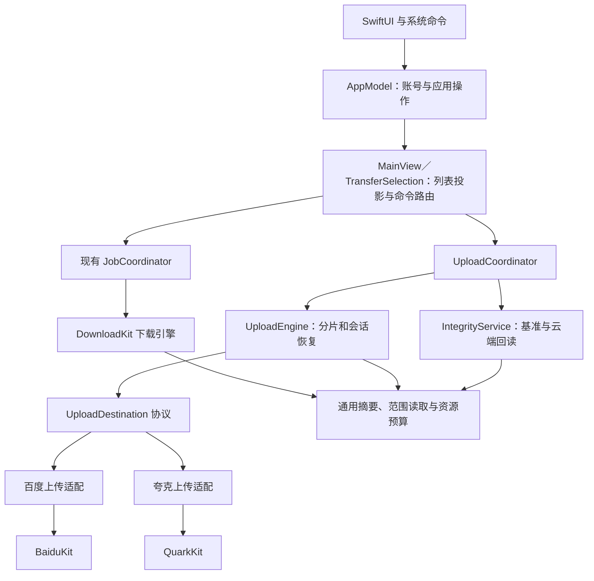

# Ferry Plus 3.0 架构设计

状态：目标设计与当前实现对应，实施进度见执行记录。更新日期：2026-10-25。产品输入为 [3.0 功能清单](features.md) V3-F01～V3-F25。

## 1. 技术结论与当前事实

沿用轻量策略：百度、夸克分别适配上传协议，共用上传调度、持久化、校验和界面投影。保留现有 DownloadKit 与下载 JobCoordinator；上传不伪装为分享转存，不给每家复制一套任务系统。维持当前四个 Swift Package target，新增上传业务放在 FerryCore。

| 当前位置 | 当前职责与事实 |
| --- | --- |
| `BaiduPCS-Swift/AppModel.swift`、`QuarkAccountSession.swift` | 双账号与会话生命周期，向上传调度传递全局／单网盘运行时阻断，凭据仍由此处管理 |
| `FerryCore/Netdisk.swift`、两家 Netdisk 适配器 | 分享、目录、转存、精确对象移入回收站；下载本身不删除账号内原件 |
| `FerryCore/Job.swift`、`JobCoordinator.swift`、`JobStore.swift` | 下载身份、恢复和校验依据；独立 UploadJob／UploadCoordinator 处理上传，没有扩大下载 Source 枚举 |
| `DownloadKit/FileTransfer.swift` | Range、长度、期望 SHA-256／MD5 的最终落盘校验；不把无基准完成当作内容已验证 |
| `FerryCore/RoutedDownloadSource.swift` | 按账号与会话版本解析地址，检查夸克返回的文件长度；完整内容比对由期望摘要及最终校验处理 |
| `BaiduKit/Models.swift`、`FerryCore/BaiduNetdisk.swift` | 百度列表不补造缺失的完整文件摘要；可使用关联原上传 SHA-256 或用户提供依据 |
| `QuarkKit/QuarkClient.swift`、`QuarkNetdisk.swift` | 传递来源明确的可选文件 MD5；OSS 分片 ETag 不用作完整文件基准 |
| `FerryCore/FerrySettings.swift`、DownloadKit `TransferBudget` | 上传、下载及回读共享连接预算，上传／下载分别限速，保留旧设置语义 |
| `FerryCore/UploadEngine.swift`、`UploadCoordinator.swift`、`IntegrityService.swift` | 正式分片执行、持久化与完整 SHA-256 回读；未决副作用和安全覆盖仍有明确未完成边界 |

源码目录均位于 `Packages/FerryKit/Sources/`，应用目录除外。最初协议可行性见 [上传验证](../upload-validation.md)，当前实现和实测证据见 [执行记录](implementation.md)。

## 2. 职责与依赖

| 所有者 | 职责及状态 |
| --- | --- |
| AppModel／账号会话 | 登录、Keychain、会话版本、目录授权；所有执行以 AccountKey 为准 |
| MainView／TransferListItem／TransferSelection（应用层） | 合并两类只读快照、筛选、选中项及命令分派；不另存一份任务执行状态 |
| UploadCoordinator（FerryCore） | 批次、文件清单、冲突决策、阶段推进、恢复核对、发布和结果；原子保存批次记录 |
| UploadEngine（FerryCore） | 文件级分片调度、确认回执、签名刷新、有限重试；只经 UploadDestination 访问网盘 |
| BaiduUploadDestination／QuarkUploadDestination | 公共请求和原生接口之间转换；分页、会话、回执和服务端错误语义属于各自实现 |
| IntegrityService（FerryCore） | 基准选择、上传回读、校验记录和版本关联；调用现有账号下载地址解析，不往用户下载列表创建隐藏任务 |
| DownloadKit 通用设施 | 可流式消费的范围读取、摘要计算、资源许可与速率预算；不识别网盘和账号。现有下载消费者仍写临时文件，回读消费者只计算摘要 |
| BaiduKit／QuarkKit | 各自 HTTP、鉴权、签名、原始响应和协议错误；互不依赖 |

通用设施仅在下载、上传／校验确实共用的部分提取，保留现有公开入口的兼容适配。不能为方便校验而直接调用当前会落盘完整文件的 finalize 流程。

## 3. 功能到技术映射

| 功能编号 | 负责模块 | 数据／接口及关键边界 | 验证点 |
| --- | --- | --- | --- |
| V3-F01 | SwiftUI、UploadCoordinator | 文件 URL、拖入上下文、待确认清单；放下与确认时分别校验账号 | 已选网盘拖入无需重选，全部网盘不误投 |
| V3-F02 | 文件扫描与清单 | 相对路径、文件身份、目录项；去重、空项目、符号链接规则 | 多层和空目录完整，重叠选择不重复 |
| V3-F03 | 两家目录适配、上传窗口 | AccountKey、RemoteReference、最近目录；建目录结果核对 | 切换账号不沿用另一账号目录 |
| V3-F04 | AppModel、上传调度 | 会话 revision、任务 AccountKey | 旧会话响应不能更新新账号状态 |
| V3-F05 | 扫描器、网盘适配 | 权限、名称、空间、文件上限；未知值保留未知 | 空间不足和源缺失可操作提示 |
| V3-F06 | UploadEngine、协议适配 | UploadSession、PartReceipt、合并回执 | 分片顺序、末片长度和回执准确 |
| V3-F07 | 两家上传适配 | 秒传结果中的远端对象引用 | 秒传也进入回读，不伪造传输字节 |
| V3-F08 | 两种调度、资源预算 | 优先级、方向、文件／连接许可 | 混合负载不越界且不饿死下载 |
| V3-F09 | UploadCoordinator、执行 worker | pause 意图及阶段检查点 | 暂停生效后无新分片，远端提交继续核对 |
| V3-F10 | 上传状态存储 | 版本化批次清单及每文件检查点 | 进程中断后不丢已确认分片 |
| V3-F11 | 调度与错误分类 | 失败阶段、服务端错误、重试次数 | 已成功文件不重传 |
| V3-F12 | 冲突／发布流程 | 原对象、暂存对象、替换意图和结果 | 新内容校验失败不破坏旧内容 |
| V3-F13 | 添加任务与清单索引 | 账号、目标、源身份／摘要 | 同名不同内容不误去重 |
| V3-F14 | MainView／TransferSelection | 带方向的任务 ID 快照、取消意图 | 操作不越过筛选范围，取消不误删 |
| V3-F15 | 两种快照与详情 | 阶段、逻辑字节、实际网络流量、计数 | 回读不重复计算上传进度 |
| V3-F16 | 结果面板 | 本地 bookmark、远端父引用、错误及校验记录 | 打开对应位置，丢失文件有提示 |
| V3-F17 | 网络配置与共享预算 | 代理 revision、上传／下载速率桶 | 回读受下载限速，重试不绕过预算 |
| V3-F18 | IntegrityService | 源 SHA-256、分块指纹、完整回读结果 | 内容不一致阻止完成和覆盖 |
| V3-F19 | DownloadKit、来源路由 | IntegrityExpectation、最终落盘摘要 | 相同大小不同内容不通过 |
| V3-F20 | IntegrityStore、导入导出 | 算法、来源、对象版本、匹配关系 | 清单不能按顺序误配或执行其中路径 |
| V3-F21 | AppModel、通知与生命周期 | 批次终态、防休眠许可 | 部分失败通知准确，空闲释放资源 |
| V3-F22 | 主窗口、菜单与设置 | 同一 TransferSelection | UI、快捷键和菜单作用范围一致 |
| V3-F23 | 扫描、HTTP、摘要、存储 | 有界缓冲和并发、元数据保存 | 内存不随单文件大小线性增长 |
| V3-F24 | 存储迁移、构建交付 | 旧任务备份、格式版本、签名身份 | 旧下载续传、登录及 App 产物核对 |
| V3-F25 | Netdisk、账号内文件树 | 确认范围包含 AccountKey、会话实例、精确条目与父目录；逐项移入回收站 | 换号拒绝执行、父子去重、部分失败明确；副作用不自动重发，删除后有限核对 |

网盘文件删除沿用两家现有回收站接口，独立于任务记录移除与自动转存清理。先在原账号父目录核对所选身份，再发送一次删除，随后有限核对原对象消失；请求失败或结果未确认时保留错误并刷新，不无条件重试。百度接口按路径删除，删除前核对 fsID 不等于服务端原子条件删除，外部客户端并发替换同路径仍有窄竞态；此约束须在验收记录明确。界面只操作当前账号自己的文件树，分享树不提供该入口。

## 4. 数据与状态所有权

以下是设计中的类型及业务含义，不代表当前代码已有实现。

| 记录 | 关键内容 |
| --- | --- |
| UploadJob | ID、格式版本、固定 AccountKey、账号名快照、目标目录引用、冲突策略、优先级、创建时间、暂停／取消意图、文件及目录清单 |
| UploadFile | 稳定文件 ID、相对路径、源 bookmark、大小、文件资源标识、修改时间、SHA-256、协议所需 MD5／SHA-1、分块指纹、阶段和错误 |
| UploadSession | 网盘、账号、上传任务标识、分片大小、已确认回执、已知有效期、会话 generation；临时签名按需刷新 |
| PartReceipt | 序号、偏移、长度、源分块指纹、协议校验值／ETag、确认结果；ETag 只按对应协议解释 |
| RemoteCommit | 合并／建目录／替换的操作 ID、本地意图、远端回执、暂存与旧／新对象引用、结果核对状态 |
| IntegrityExpectation | 算法（sha256／md5）、摘要、依据来源（本地原始／已验证语义的远端／用户提供）、大小、远端身份及版本线索 |
| IntegrityRecord | 基准、实际摘要、结果、验证时间、远端身份、原上传文件关联；独立于可移除的任务列表 |
| TransferSnapshot | 方向（upload 上传／download 下载）、原任务 ID、网盘、账号、标题、阶段、计数及校验状态；仅供 UI 投影 |

本地计划存储：保留 `jobs.json` 和 `Downloads/`；新增 `Uploads/<jobID>/` 保存批次和分文件元数据，`Integrity/` 保存摘要及关联。均为版本化记录、原子替换写入，不保存完整源文件。按目录逐步枚举和分文件载入，列表只持有批次聚合与当前可见明细，避免一次扫描把整棵文件树和全部分片常驻内存。

下载分片记录新写入显式 `version=1`。缺少版本键的旧记录仍按原格式读取，保持原 ID、路径、位移和暂停状态；显式版本必须为已支持的整数版本。未知版本或无效类型在引擎调度前拒绝，保留原 JSON、完整文件和分片；App 显示实际恢复失败原因，不将格式错误统一归为权限问题。升级前原始元数据备份继续保留，旧版回退使用原备份。

上传文件检查点与批次汇总分别原子保存，重启时以已落盘文件为计数依据。恢复逐文件计算字节、成功、失败和跳过数，所有批次读取和汇总保存完成后才发布与调度，不推断阶段或改变用户暂停。恢复期间新增与重复恢复明确返回忙碌，避免覆盖新任务；读取／保存错误沿原恢复错误入口展示，不当作空记录或零进度。每批只读取一次权威清单，逐个读取并校验成员检查点后累加，不同时装入全部文件记录。运行中的分片确认仍增量更新，不新增逐进度全批扫描。

服务端副作用前先保存意图，收到确认后保存回执；状态保存失败应停止发起下一步，不能继续到不可恢复的合并／覆盖。Cookie、短期下载 URL、OSS 签名不写入任务日志或普通检查点；恢复所需且不能重新取得的敏感上下文放入 Keychain，普通状态只引用它。

目录创建的准确回执通过 `onCreated` 即时交给原账号任务持久化，先保存目录引用与已确认提交，再执行后置会话检查。换号或取消不丢弃已收到的目录身份；保存失败不继续，恢复已有准确回执时不再次创建。真正响应丢失仍保留未决，不能按同名目录推定创建成功。

预创建同样先保存 `prepare` 意图（建立原会话或秒传产物）；准确 `onPrepared` 回执与意图确认写入同一个文件记录。Quark 后续协商可多次回调，只更新原会话，不新增预创建。无身份秒传、网络／解析／未知服务错误保留 pending（未决）；只有协议明确拒绝才记 rejected（未执行），允许修复后重试。未决准备不套用合并查询，不重新预创建，取消和移除也不能丢掉该记录。保存意图后但尚未调用策略的本地取消可明确拒绝；拒绝写失败仍保留原未决。

## 5. 状态与完成条件

首次远端写入前，沿用原 worker 完成批次源基准准备。指纹逐文件持久化，正式发送复用，不为判重额外完整哈希；普通源错误标记对应文件失败，其余项目继续。已确认远端对象只使用保存的原始摘要回读，不要求本地源仍存在。

重复识别使用同账号、准确目标引用及完整相对路径／目录类型／大小／文件 SHA-256 的有序清单摘要，包含空目录，不包含本地绝对路径。添加时保存当时活动批次的候选 ID；默认单队列轮到新批次时，原候选可能已经完成，仍可提醒。提醒在内容准备完成后出现，新增批次暂停且未写云端，可定位原任务或明确选择仍然上传。已失败／取消的候选不阻断，不用名称和大小猜测缺失摘要。明确继续后保留内容签名，重开不会反复自阻断。

上传文件主流程：`preparing`（检查／哈希）→ `queued`（等待）→ `uploading`（发送分片）→ `committing`（合并核对）→ `verifying`（云端回读）→ `publishing`（仅覆盖时替换）→ `completed`（完成）。目录建好不代表其内容完成。

暂停和取消意图与当前阶段分开保存。可中断阶段停止 worker 并保存确认进度；committing／publishing 中的暂停或取消先停止后续调度，状态为“正在核对结果”，核对结束后应用意图。失败保存原阶段；重试从该阶段进入，不能统一从上传重新开始。

校验结果独立为 `pending`（待验证）、`verified`（比对通过）、`unavailable`（缺少依据）、`mismatch`（内容不符）。上传必须 verified，且最终对象核对通过；下载允许 unavailable 生成正式文件，但必须显式展示未验证。 下载状态行和完成通知共用整批判据：非空文件清单中每个文件均已落盘、具有明确基准且校验通过，才保持普通完成展示；混合结果、旧记录和缺依据批次明确标记“未验证”。校验网络失败仍是 pending 加失败原因，不能改成 unavailable。

批次按子项聚合：有失败项为部分失败／失败；有未结束项保持活动；成功加跳过显示各自数量；全部跳过单独描述。取消项不能贡献成功数。旧下载完成记录迁移为“历史完成、未记录校验依据”，不反推 verified。

## 6. 上传策略契约与协议

| 操作 | 输入与结果 | 约束 |
| --- | --- | --- |
| prepare | 账号、目标、稳定文件清单及摘要 → 分片会话或秒传对象 | 协议自己决定分片参数；不以空回执表示秒传 |
| rapidUpload（可选） | 已持久化普通会话、固定账号及真实证明读取器 → 准确秒传对象或明确未命中 | 先预算证明字节与连接；提交前保存独立意图，未知结果不重发 |
| inspectSession | 保存的会话 → 可续传及确认分片／过期／结果待核对 | 能力必须通过真实验证，不能凭本地进度假设服务端保留 |
| uploadPart | 会话、分片及已核对的字节流 → 确认回执 | 请求读取的内容必须与分块基准一致；失败未确认的片可重发 |
| complete／inspectCommit | 完整回执清单／已存提交记录 → 精确远端对象或明确未决 | 响应丢失先核对，不按同名同大小认领对象 |
| publishReplacement | 校验后的暂存对象、原对象版本 → 最终对象及可恢复旧版本 | 能力验证通过才启用，禁止先删后传 |
| abort／cleanupOwned | 已记录会话／自有暂存对象 → 已清理或待核对 | 不清理用户目标目录及已成功文件；云端删除使用回收站 |

百度会话路径：校验取得 bdstoken → `/api/precreate` 并持久化会话 → 可选 `/api/rapidupload` → 未命中时以原 uploadID 调用 `superfile2` 分片及 `/api/create` 合并 → 准确身份核对 → 原始下载地址完整回读。独立秒传只用于保留两份策略、源文件大于 256 KiB 且尚无已发片的会话；跳过策略保持原路径。读取原源文件中服务端公式指定的 256 KiB 真实内容，前后核对文件路径及描述符身份，不缓存完整文件或将证明内容写入记录。

秒传前校验当前 UK 与固定账号一致，先取得 token，再生成时间挑战。Native 在实际 POST 前回调编排层原子保存 `rapidUpload` 意图及表单长度；记录不含表单、Cookie 或证明字节。只有 HTTP 成功的业务 errno=404 表示明确未命中，确认该尝试且保留原会话继续传片。成功同时保存准确对象、秒传准备回执及提交确认，再进入完整 SHA-256；网络、HTTP 404、解析及缺失身份均保留未决，不重复秒传或预创建。明确登录／空间拒绝可以修复原因后显式重试。

夸克路径：`/file/upload/pre` → `/file/update/hash` → 命中时使用预分配 FID 核对并回读；未命中时 `/file/upload/auth` → OSS 分片及合并 → `/file/upload/finish` → 准确 FID 核对并完整回读。两家非空秒传已有独立真实内容实证；未知结果自动恢复、远端 abort 和安全替换仍按各自任务验证。

OSS 只使用本次对象存储签名，不携带网盘 Cookie。协议参数、会员大小限制和服务端指定分片大小留在适配器中；下载 Range 大小与上传分片大小是两件事，不能把探针的 4 MiB／256 KiB 当成通用固定规则。

## 7. 源文件与内容校验

### 7.1 原始基准和上传读取

打开授权文件，检查稳定资源标识、大小和修改信息；流式计算全文件 SHA-256、协议摘要和分块指纹，前后再次核对文件状态。扫描清单固定本批次范围，后来新增的文件不悄悄加入。

发送每块前核对其内容指纹，发送经过核对的同一批字节，不能核对后重新从可能变化的路径无条件读取。按许可限制缓冲；协议分片很大时采用分块可重放读取／显式受限暂存，不把整文件装入内存。重新定位源文件需重新比较基准；任何变化不得把旧分片拼入新版本。

当前重新定位以单文件为单位，由 UploadCoordinator 跟踪完整复核任务并纳入暂停／退出收尾。只有已有原始 SHA-256 的发送前失败项可重新绑定；完整内容一致后更新授权和本地身份，保留原生会话与确认回执。目录整批映射不按同名猜测，没有原始依据的项目重新添加。

### 7.2 上传回读

IntegrityService 使用精确远端对象重新解析下载地址，以 Range 和 `Accept-Encoding: identity` 获取原文件字节；核对状态、Content-Range、长度及版本线索，以文件顺序送入 SHA-256。并发返回的片段只在有界缓冲内重排，某段未完成时不无限预取后续内容。空文件走零长度对象读取与空内容摘要验证，不生成 `bytes=0--1`。

传输层不能把重试前收到的半段和重试后的完整段重复送入摘要。每个小范围完整核对后才推进连续哈希；网络失败重试该范围。暂停、取消和进程退出均不保留部分摘要上下文；恢复当前未完成文件时从零回读并重算 SHA-256，不序列化 CryptoKit 的内部状态。已完成文件只读取记录，不重复回读。不得把各分片 SHA-256 拼接后称为全文件 SHA-256。

UploadCoordinator 在运行时保存当前回读文件、已读字节和总字节，通过 UploadJob 只读快照展示独立校验进度；该投影明确排除在 JSON 检查点之外。范围完整消费后推进，结束或取消即清空，不增加定时器或进度落盘。上传发送 100% 后仍展示校验阶段，只有完整摘要匹配并保存校验记录才完成。

回读不保存完整副本。上传完成后源文件被移除，也能依靠持久化的原始 SHA-256 完成云端回读。验证结果仅证明该时间点读出的对象内容；文件之后变化需重新验证。

### 7.3 下载校验及记录关联

基准优先顺序：用户本次明确指定的期望版本／摘要 → 可明确关联的本地原始 SHA-256 → 语义确认的远端完整文件摘要。多个基准互相冲突先报告，不静默择一掩盖变化。关联键包含网盘、账号、远端对象身份和版本线索；名称、路径、大小只能辅助查找。

补齐百度摘要解析、夸克依据校验，并贯穿 RemoteEntry → 文件清单 → DownloadRequest → 下载完成结果。下载刷新地址时重新检查源身份、大小及可用版本线索；最终从本地临时文件流式计算摘要，验证后同卷移动到正式位置。缺乏版本线索也必须做最终内容比较；无任何内容基准则明确 unavailable。

摘要不符时保留临时文件，停止当前任务并重取元信息核对。重新下载由明确的重试／重新开始动作触发，不能只反复对同一坏文件计算哈希，也不能把期望摘要改成实际摘要。分享自动清理门槛同步改为所需校验通过；无依据时保留转存源并说明占用。

清单导入仅支持明确算法、合法十六进制长度和文件匹配；多条记录按安全相对路径与大小等信息确认匹配，不按行号匹配，不执行或写入清单中的绝对路径／父级路径。清理任务默认保留小体积校验记录；提供单独清理入口与占用统计，清理后未来下载可能缺少原始依据。

## 8. 冲突和不确定结果

保留两份由服务端不覆盖语义或原子创建结果确定最终名称，不能仅先查询再使用会覆盖的写接口。同名目录合并只复用确认的目录对象；目录／文件类型冲突需用户决策。

覆盖流程必须验证：新对象暂存 → 完整校验 → 记录发布意图和原对象身份 → 受并发保护的替换 → 核对最终对象。发布必须具有原子条件替换，或经验证具有等价保护的精确对象操作及最终不覆盖发布；一次事前查询、仅按对象 ID 操作都不能证明外部并发更新已被排除。旧版本可恢复是另一项必需保障，不能替代并发保护。两项任一不满足即为能力阻断，停止该项并保留两份，不声称覆盖已经交付。若发布生成新对象且服务端不能证明内容身份延续，对最终对象再回读校验。

合并、建目录、发布前持久化操作身份；恢复查询按会话回执及精确对象 ID。结果未知时不自动覆盖、不自动重新建同名对象；无法进一步查询则显示待处理。退出后恢复仍遵守同一规则。

取消先阻止新操作，再等待在途请求的收尾和核对。记录不可在仍有远端不确定结果时直接丢弃；用户界面可收起，但后台需保留最小恢复记录。清理只按已记录归属对象执行，不以目录前缀猜测所有权；失败显示可定位的残留位置。

上传窗口确认新建目录时冻结父目录、账号和会话；异步任务真正发出创建请求前再次核对当前上下文及取消状态。上下文已变化则不发送写入，已发请求的迟到结果不跳转新目录或覆盖新会话界面。

上传批次执行仍使用原 `failed` 阶段；界面按完成／失败／跳过计数投影结果。终态有失败且另有完成或跳过项时，列表、明细、详情统一显示“部分失败”，通知采用同一判据；全部失败继续显示“上传失败”，单文件阶段名称不变。

## 9. 网络、资源与生命周期

复用现有代理并按配置 revision 替换网络会话；先停止旧 worker 写检查点，再启动新 worker，避免两代同时写同一分片。退出账号也撤销旧会话执行权并保存进度。

下载、上传及回读共享连接许可，上传与下载各有速率预算，回读归下载预算。等待重试和校验不长期占着已不用的上传连接；一次租用按固定顺序取得所需许可，任务切换阶段先释放旧许可，避免互相等待。优先级影响待执行项目，回读不独占全部下载资源。

上传批次和文件内分片并发分别设置，默认各 1，分片上限 4。每片领取共享速率额度后才读取缓冲，连接许可仍受总预算限制；父任务串行保存回执，任一错误或取消后先取消并收齐全部在途结果，再退出并关闭源描述符。修改分片并发只影响下一次执行器，不取消已经发出的请求。20 MiB 分片的 4 路原始缓冲约 80 MiB，另加协议和系统开销，并乘以同时上传批次数。

限速通过有界读写和背压实现，URLSession 已缓存的字节也纳入内存测量。哈希扫描默认低并发，分片数和目录规模只增长元数据，不扩大文件内容缓冲。普通退出、暂停及无任务时停止进度 ticker、后台轮询和防休眠许可。 启动恢复的每个异步边界核对退出标志，退出后不再启动账号验证；后台夸克启动验证由 AppModel 持有并在退出时取消，验证任务不跨等待强持有 AppModel。百度验证的迟到成功与过期响应也不能在退出后保存凭据或改变账号状态。

超时区分连接、无进展和合理的单请求资源上限；资源上限结合范围大小、设置速率和实际进展制定，不能复制探针固定 20 秒或用短总时限截断持续传输。403 先按请求阶段分类：账号 API 拒绝、CDN 请求形式／短期地址问题分别处理，不能一律退出登录。

## 10. 兼容、验证与能力门槛

新增上传与校验记录不改动 2.0 下载 ID 和临时路径。升级前备份受影响下载元数据；新格式有独立版本，未知版本明确报错并保留数据。完成记录缺校验依据就标为历史未验证。回退 2.0 只能使用升级前下载备份，不能同时让两个版本写同一状态目录；3.0 上传进度不承诺由 2.0 读取。Keychain 服务名、固定签名和应用身份保持一致。

| 能力 | 当前证据 | 剩余实现／发布门槛 |
| --- | --- | --- |
| 空文件、空目录、非空秒传 | 两家正式上传、完整回读及部分实际 App 验收已通过；非空秒传见 T08 执行记录 | 账号权益和文件上限仍以可获取信息及服务端拒绝为准，不能外推所有大小能力 |
| 有效会话续传、过期及未知提交 | 两家跨进程复用原会话、只补剩余片并完整回读通过；提交意图和准确对象查询已接入 | 缺失对象不能证明先前未提交；过期自动重建、未知准备／建目录／合并核对及远端 abort 仍待闭环，T07／T10 未完成 |
| 安全覆盖与并发冲突 | 已验证部分名称冲突拒绝和百度一条更新路径；尚无满足条件版本保护及旧内容恢复的完整证据 | 两家均需证明服务端条件发布和旧内容可恢复；保持发布阻断，不能以保留两份或仅事前查询代替 |
| 摘要及版本语义 | 已接入原上传 SHA-256、用户基准、来源明确的完整 MD5、冲突拒绝及版本化校验记录 | 无可靠远端版本时保留原始依据并实际比较，不仅凭文件 ID 沿用历史通过结果；无依据明确未验证 |
| 限速、资源和大文件 | 已有六路实际云端混合传输／代理替换、低速链路、流式内存修复及空闲 App 观测 | 原多 GiB 上传按用户要求保持暂停，不重复等待；完整混合负载峰值、结束资源释放和最终 App／ZIP 仍由 T17／T19 验收 |
| 实际界面与生命周期 | 两家部分上传、回读、删除、目录及升级验证已有记录；最新修复已构建 | 拖放／换号／浅深色等完整 GUI 与物理睡眠仍未验收；Mac 锁屏阻断实际界面操作，T13／T15／T18 不勾选 |

技术验证按 [任务清单](tasks.md) 执行：先接口门槛，再协议和恢复，再 UI 与资源验收。复用现有会话、已有测试和受控验证入口，不新增测试类；真实文件和目录操作的证据保留供人工复核，不以静态检查代替现场结果。静态审查、隔离验证和实际 App 操作各自保留证据范围；完成状态按每项完整验收标准判断。
