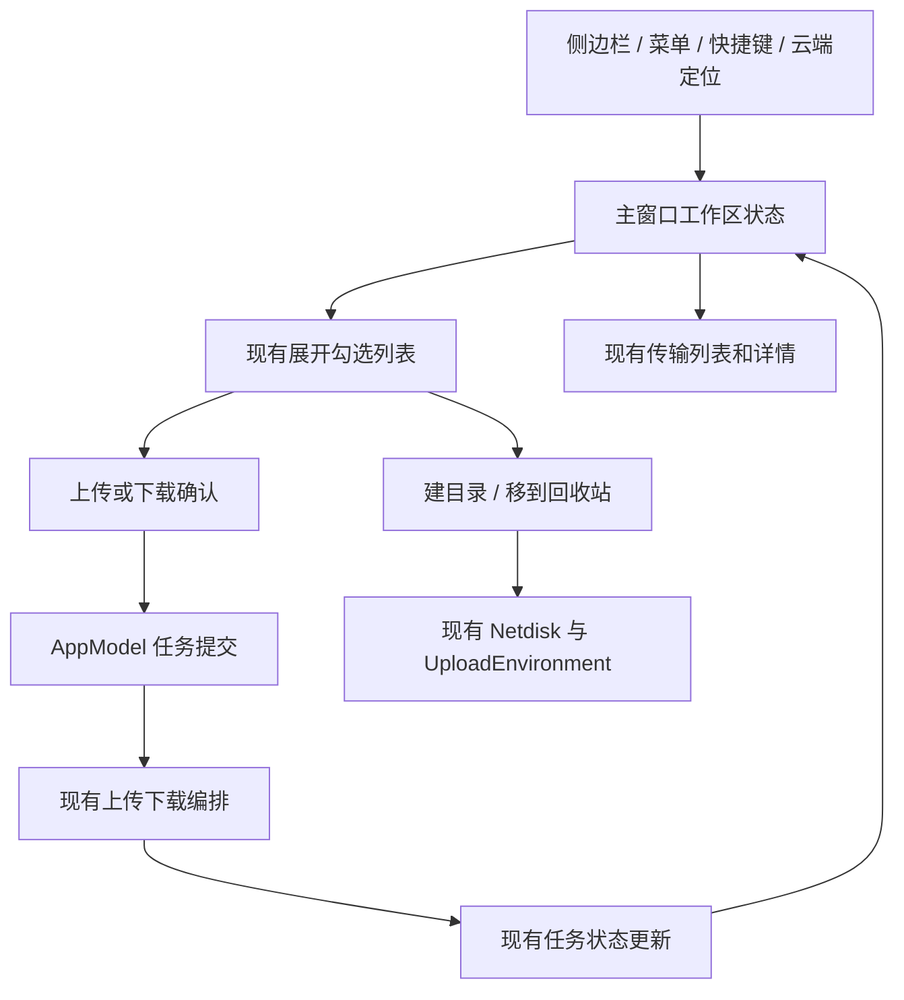

# Ferry Plus 4.0 技术方案

状态：已进入实施与验收，实际完成情况见 [实施记录](implementation.md)。日期：2026-10-28。设计源码基线：`main@63ff505`。

输入：[产品方案](product-proposal.md)。实施拆分见 [任务清单](tasks.md)，验证见 [测试用例](test-cases.md)，设计审查见 [Review](review.md)。

## 1. 技术结论与现状

在现有 SwiftUI 主窗口内增加文件工作区，首版直接沿用当前下载页的 List、文件夹展开和勾选样式，把上传、下载窗口拆成目录浏览和精简确认两部分。复用 `Netdisk`、`UploadEnvironment`、`AppModel` 的任务提交与传输编排，不新增协议层或通用插件体系。

下列事实来自当前源码阅读，不代表 4.0 已实现或验收通过。

| 当前代码 | 现状及改动意义 |
| --- | --- |
| `MainView.swift`、`SidebarView.swift` | 主页面仅以传输分类为导航；筛选、任务选择、详情及批量操作由 MainView 持有。需要增加页面路由，保留传输状态独立性 |
| `ContentView.swift`、`BaiduPCS_SwiftApp.swift`、`AppModel.swift` | sheet、应用菜单及待处理打开请求共同控制上传下载窗口；不能只删工具栏按钮 |
| `NetdiskDownloadView.swift` | 私有目录树、删除、嵌套上传、校验选择及下载提交混在一页，提交后 dismiss；目录浏览与确认需要拆开 |
| `UploadView.swift` | 本地选择、目录导航、建目录、预检查、同名策略及提交混在一页；提取确认能力，目录改由工作区提供 |
| `FileTree.swift`、`FileTreeRow.swift`、`AddLinkView.swift` | 当前下载页和分享选择使用同一文件树；首版继续复用 List／FileTreeRow 的展开、勾选和三列布局，调整共享组件前核对分享调用方 |
| `AppModel+UploadDirectories.swift` | 最近上传位置与实际浏览位置语义不同；建目录已有准确回执和有限可见性核对，可复用 |
| `UploadListView.swift` | 云端结果通过嵌套 NetdiskDownloadView 展示；需要改成关闭详情后导航主工作区 |
| `Netdisk.listDirectory` | 返回一个目录的全部条目数组，适配器内部翻页；UI 不需要另建分页协议 |
| `BaiduClient+Disk.swift` | 重复页目前终止并返回已收集条目，缺失身份会跳过、缺失大小可能填 0；不满足新文件页完整性要求，需局部修正 |
| `QuarkClient.swift` | 内部完成分页、检查重复 ID 与总数；失败抛错。夸克目录引用是 fid，不是完整路径 |
| `AppModel.startUploads` | 已订阅上传任务快照；可以据状态变化刷新目录，不增加一套传输轮询 |

## 2. 功能追踪编号

产品方案未设编号，以下按章节顺序建立追踪编号，不改变产品范围。

| 编号 | 产品功能及出处 | 负责模块／数据接口 | 关键边界与验证点 |
| --- | --- | --- | --- |
| F-01 | 主窗口与导航（§4） | MainView、SidebarView、WorkspaceState；页面路由和浏览位置 | 首次百度、恢复页面、两家位置独立、传输筛选不变；TC-01～04 |
| F-02 | 列表浏览与目录导航（§5.1） | NetdiskFilesView、DirectoryBrowserState；UploadEnvironment.listDirectory、RemoteEntry | 分页完整、逐层展开、勾选与搜索排序范围、迟到响应与路径失效；TC-05～12 |
| F-03 | 上传与拖放（§5.2） | UploadConfirmationView、待上传草稿；AppModel.addUpload、UploadPreflight | 当前目录／行目标、确认冻结、取消、同名与重复任务；TC-13～18 |
| F-04 | 下载（§5.3） | DownloadConfirmationView；addNetdiskJob、现有下载引擎 | 保存授权、选择冻结、一次入队、后台检查与旧数据兼容；TC-19～23 |
| F-05 | 新建文件夹（§5.4） | 文件页操作、现有 createUploadDirectory | 准确回执、取消、隐藏结果提示、不自动进入新目录；TC-24～25 |
| F-06 | 删除（§5.5） | 文件页操作；Netdisk.moveToTrash | 当前可见选择、右键范围、部分失败、未知回执不重发；TC-26～29 |
| F-07 | 旧入口承接（§6） | ContentView、应用菜单、UploadListView、AppModel 导航请求 | 快捷键焦点、详情 sheet 关闭顺序、分享树保留；TC-30～34 |
| F-08 | 账号、刷新与兼容（§7） | WorkspaceState、账号会话、uploadJobs 更新、UserDefaults | 不串号、不抢页面、不按进度轮询、不迁移任务格式；TC-35～40 |

## 3. 职责与状态所有权

以下新名称是设计建议，不表示当前已有该类型。仅拆分有独立状态或生命周期的职责。

| 状态所有者 | 内容 | 生命周期与职责 |
| --- | --- | --- |
| `AppModel` | 现有账号、Netdisk 实例、传输队列、上传快照、主窗口打开能力 | 继续负责跨窗口业务能力；新增一个待消费的工作区导航请求，不承载列表 UI 草稿 |
| `WorkspaceState`（主窗口持有） | 当前页面、最近网盘、每家当前账号的浏览状态、待上传文件及导航请求消费 | 主窗口级 `@Observable` 状态；切换文件／传输页不销毁进行中的确认或草稿；不缓存全盘目录树 |
| `DirectoryBrowserState`（每家一份） | AccountKey、会话标识、目录引用、已知导航路径、FileTree、节点读取代次、加载／错误、搜索、排序、勾选 | 一家保存当前列表根及按需展开的已加载子树，路径只存导航节点；切换列表根释放旧树，不构建全盘缓存；按账号和会话失效，旧请求不得回写 |
| 原 MainView 的传输状态 | 网盘／方向／分类筛选、任务搜索与选择、详情和批量流程 | 与文件选择隔离；可整理成 TransferWorkspaceView，保留原逻辑和稳定状态所有者，不因切页面重建后丢失状态 |
| 主窗口确认流程 | 一份上传或下载草稿、建目录／删除请求及结果 | 操作请求冻结后执行；同一窗口同一时刻只展示一个确认流程，已有面板不被菜单请求覆盖 |
| UserDefaults 中独立的工作区偏好 | 版本、最后页面、最近网盘、按 AccountKey 保存的目录引用及已知路径 | 仅导航偏好；不保存会话对象、选择、文件列表、Cookie 或未提交本地文件授权 |

## 4. 目录读取与展示

### 4.1 请求和快照

目录请求包含 `AccountKey`（账号归属）、当前 Netdisk 会话标识、`RemoteReference`（准确目录身份）、树代次及节点读取代次。根目录和每个展开节点分别按需读取；切换列表根、刷新、换会话时取消相应旧读取，收起节点取消其在途读取。返回前核对账号、会话、树与节点身份和取消状态，防止慢子节点请求写回已替换的树。

文件工作区复用 `model.uploadEnvironment(for: account).listDirectory(reference)` 作为读取入口：它使用相同分页能力，并在百度通过已有 `checkedBaiduDirectoryPath` 校验 fsID。不能只调用忽略 fsID 的 BaiduNetdisk.listDirectory 来证明目录身份；同路径被删除重建后，旧引用必须报失效，不能当作原目录继续操作。这里复用现有入口，不启动上传，也不新增协议。

首次进入显示加载页，每个节点成功后一次发布其完整直接子项。子节点加载、空目录、读取失败及重试沿用当前下载页行内展示，不能把子目录失败当成根目录整体失败。刷新保留旧树并显示刷新状态，失败保留旧内容和更新失败提示；首次失败不能显示空目录。根目录加载期间不宣称完整全选；刷新旧树时暂停新增操作确认，成功后恢复。刷新按准确引用重建根和仍展开的分支，逐层核对后恢复可见勾选，不因恢复展开而读取未展开目录。

适配器继续处理每层目录分页，不因初次进入而递归读取子目录；仅用户展开节点或明确进入目录时读取该层。百度重复页且无法证明结束时抛出明确的不完整目录错误；必要身份、文件类型或文件大小缺失／非法时报告响应异常，不跳过条目或用 0 代替未知大小。真实零字节文件仍合法，缺失修改日期显示“—”。错误不发布半份新列表。检查此处共享调用方：分享转存准备、递归文件枚举、上传预检查、删除前核对、最近路径校验；正常分页结果保持不变。夸克已有重复和总数检查继续复用。

这是针对完整目录语义的有限修正，不重写两个 SDK。现有接口没有服务器快照版本，因此无法承诺分页期间外部修改的一致快照；异常提示刷新，操作前继续使用已有身份核对。

### 4.2 列表、排序与勾选

从 NetdiskDownloadView 提取现有 NetdiskBrowser 为可复用文件列表，继续使用 SwiftUI `List`、`DisclosureGroup`、`FileTree` 和 `FileTreeRow`。首版不改用 Table 或原生整行多选；日期、大小列沿用共享宽度，所有深度的缩进仅占名称区域，表头和行尾列对齐。

保留 FileTree 的显式勾选与父目录包含语义：勾选父目录时清除独立子项选择，子项显示继承选中且不可单独取消；selectedEntries 只返回最上层已选条目。勾选目录包含尚未展开的内容，确认必须说明递归影响，不能把其显示为仅已加载子项。根目录全选勾选当前可见顶层条目，不递归读取所有内容。

同一排序规则用于每个已加载节点的同级子项：默认文件夹在前、名称升序；日期／大小排序仍保持文件夹在前，未知值置后，同值按名称及引用稳定排序。仅名称区域层级缩进，父子不能在排序后混排。

搜索只过滤当前列表根的完整直接子项，使用名称本地化、不区分大小写包含匹配。搜索期间隐藏子树且不触发子节点请求；匹配文件夹不表示其内容匹配。进入搜索、收起节点时，清除不再可见的独立后代勾选；父目录本身仍可见且已勾选时保留其整体目录语义。清空搜索后可以恢复原展开状态，但不恢复被移除的隐藏选择。

执行按钮再次从当前可见勾选中取得顶层去重对象；右键未独立勾选的行只作用于该行，右键独立勾选的行作用于可见勾选组。父目录继承选中的子行不冒充独立勾选，右键时只作用于该子行并明确确认。每个对象从树中取得自己的准确父目录，不能把展开子项都当作列表根的直接子项。

点击展开箭头不改变当前列表根、工具栏上传目标或新建位置。双击文件夹进入为新的列表根，切根清空搜索与选择，保留真实导航路径；切换网盘清空选择但保留各家位置和运行期间的展开状态。文件页的 Command-A 调用当前可见顶层全选，Command-F 聚焦文件搜索；不要求 Command／Shift 行选择。

### 4.3 导航路径与恢复

正常逐级浏览保存真实经过的路径节点，点击路径节点或返回上级时使用其准确引用。恢复上次目录时确认账号一致并读取目录；失败提示失效位置与返回操作，不能静默提交到根目录。换账号清空该网盘旧页面，从新账号根目录开始。

直接从上传结果定位时，只有 fid 的夸克目录可能没有完整祖先路径。只展示已证实的节点，例如“根目录 / … / 已定位目录”，未知路径不拼接、不全盘搜索补齐；提供回到根目录，返回上级只在父级已知时启用。若只能确认目录身份，显示“已定位目录”及可查看的准确引用，不伪造目录名。百度可显示路径，但需要准确身份的操作仍以读取结果为准。这个限制适用于确认面板中的位置展示，不能把未知祖先表示为根目录直接子级。

## 5. 上传、下载及目录操作

### 5.1 上传草稿和确认

文件页点击上传 → 复用 UploadOpenPanelPresenter → 获得本地 URL → 冻结账号、会话、目标引用、可证实路径 → 精简确认。文件夹行拖放使用行引用，空白拖放使用当前目录；普通文件行拒绝投放，不向父级空白处理冒泡。避免行级与窗口级 drop 同时接收造成双重提交。

从传输页拖入时，WorkspaceState 暂存本批本地 URL，切到最近浏览网盘（无记录则百度），显示“待上传 N 项，选择目录后确认”及取消入口。用户可在两家之间导航，确认目标后才建立绑定账号的上传草稿；不能由原传输筛选决定目标。选择文件夹期间草稿在内存保留，显式取消后释放，重启不恢复未提交草稿。

UploadConfirmationView 复用原本地文件区域、同名策略、UploadPreflight、容量检查、重复任务识别入口和授权处理，不包含目录浏览器。读取权限保持到提交生成 bookmark 或取消，面板关闭时取消尚未完成的选择器和预检查；不能只保留失去授权的 URL。沿用 AppModel.addUpload 提交与后续重复任务提示；确认中的网盘与目录不可修改。

预检查、提交前校验冻结账号和会话。账号或会话变化使确认失效并说明原因；导航刷新本身不改变目标。提交一次成功后关闭该面板并清理草稿；提交报错保留草稿和可重试说明，不自动重复发送。正在提交时禁用重复确认；已提交任务的运行不依赖面板存活。

### 5.2 下载确认与内容校验

DownloadConfirmationView 接收冻结的 AccountKey、会话、RemoteEntry 数组及来源目录，仅展示来源、文件和本次保存位置。取消不创建任务；点击下载时核对固定会话并同步调用一次 AppModel.addNetdiskJob，然后关闭确认。目录递归继续由已经持久化的任务执行，入队后沿用已有暂停、取消和失败规则。

按用户最新要求，删除确认页的 IntegritySelection、手动摘要、历史候选查询、JSON 导入及相关异步请求和草稿，不另建隐藏模式，也不自动把历史候选升级为可信当前依据。确认页不再需要入队前递归或等待历史记录。

后台 JobCoordinator 仍将可用文件 MD5 传给现有下载引擎，保存旧任务中已有的显式 integrityExpectation／downloadIntegrityBindings 兼容能力；上传完整回读、记录查看与导出不变。本次简化不改变摘要含义或把无依据文件标成已验证，完整源文件比对继续通过验收样本证明。

当前 MainView 监听 lastAddedJobID／lastAddedUploadID 会 reveal 任务，需改为：在文件页发起时仅展示“已加入传输”反馈及查看按钮；用户点击才切到传输并定位任务。在传输页发起分享任务仍保留原定位行为。

### 5.3 建目录和删除

建目录复用 AppModel.createUploadDirectory 的一次创建、准确回执、有限读取确认。新文件页成功后留在父目录刷新并突出新行；不沿用旧 UploadView 自动进入新目录的行为。搜索隐藏新行时提供清除筛选查看。未知结果显示“结果未确认，请刷新核对”，不自动再次创建。

删除冻结账号、会话和目标数组，每个目标携带其在树中的准确父目录，先按父子关系去重，再确认并逐项调用 Netdisk.moveToTrash，保留现有身份校验及有限回执核对。确认成功项、失败项、未确认项分别记录；禁止把不确定异常当成已成功或自动重发。刷新对应父目录后展示实际结果，重试由用户重新选择发起。切换账号后停止尚未发出的删除，已发出部分按原账号记录结果，不对新账号补发。

按已知任务引用、百度路径或已知目录链判断传输关联；不为提示全盘遍历夸克祖先。无法证明无关联时确认框始终提示“删除文件夹及内容可能影响进行中的传输”；可确定关联时补充任务信息。删除不调用任务移除或本地删除。

## 6. 刷新、入口和兼容

### 6.1 刷新策略

- 建目录、删除后使对应账号的目录失效，当前仍在该目录时读取一次。后台操作返回不得把用户拉回原目录。
- 利用现有 uploadJobs 更新，比较任务从非终态到 `completed`（完成）、`skipped`（跳过）、`failed`（失败）或 `cancelled`（取消结束）的变化；只在转换发生时通知该账号目录失效，不按字节进度刷新。启动初始快照作为基线，不把历史完成任务逐个当成新事件。
- 两家各一份根目录和按需展开子树，上传结束可保守使该账号当前快照失效，避免夸克未知祖先漏刷；可见时合并刷新当前根和仍展开的分支，隐藏时只标记。返回文件页重新读取，覆盖期间的外部变化；不读取未展开分支，不建立无限目录缓存。
- 刷新请求在途时，多个失效合并为一次后续刷新；每次请求关联代次，不能以旧响应清除新产生的失效标记。已暂停但尚未结束的上传产生的部分结果可手动刷新查看。

### 6.2 入口迁移

主窗口提供导航请求：打开网盘、准备上传、定位云端目录／文件；载荷携带具体目标和必要的账号。关闭窗口后菜单仍能先打开主窗口，再消费一次请求。已有确认面板时不替换内容，沿用不覆盖当前操作的规则。

ContentView 只展示分享窗口与精简确认；取消旧 netdiskDownload sheet 路由。BaiduPCS_SwiftApp 的网盘菜单改为导航，Command-U 和搜索根据当前页面派发。文件页不发布 TransferSelection 或传输详情焦点绑定，避免应用“任务”菜单在文件页操作后台遗留选择。切回传输页重新提供当前范围。

UploadListView 的结果／备份定位先取得现有准确目录结果，再由主窗口关闭详情并消费导航请求；不在详情里再嵌套浏览窗口。定位同账号任务时清除会隐藏目标的搜索，读取后定位已知文件；只知道目录则只定位目录。原账号未登录或换号时提示，不使用当前另一账号读取。

迁移完全部调用方再清理旧完整 UploadView、NetdiskDownloadView 私有浏览状态及废弃路由。保留新文件页和 AddLinkView 共用的 FileTree／FileTreeRow，以及仍被其他流程使用的摘要、选择器与格式化代码；不遗留两套目录浏览和重复提交入口。

### 6.3 数据与交付

工作区偏好使用独立版本键，缺失时默认百度；解析失败只重置此导航偏好，不重置账号、任务和设置。仅保留当前两家账号的偏好，退出／换号清理相应会话和选择，旧用户目录不自动带给新账号。

任务、上传检查点、摘要记录、Keychain 服务名、Bundle ID 和固定签名身份不变；旧最近上传目录键不直接当作最后浏览位置。旧键的调用清理在新路径全部迁移后完成，不批量清理用户历史数据。回退 3.1 时它忽略新偏好，仍读取原任务数据。

应用仍通过现有构建／打包脚本生成 arm64 App。验收候选使用实际产品版本；正式发布时同步 README、CHANGELOG 与 Cask 的版本及产物摘要。当前实施授权包括构建和实际 App 验证，发布与替换本机正式版按届时指令执行。

### 6.4 可简化与删除清单

以下根据当前调用方确认，是完成替代和验证后的清理目标，不是立即删除清单。迁移后的文件名称可以沿用，验收看旧职责和重复入口是否消失，不以删除文件数量衡量。

| 编号 | 当前内容与位置 | 可简化或删除部分 | 必须迁移／保留及清理条件 |
| --- | --- | --- | --- |
| S-01 | `ContentView` 的 `.netdiskDownload` 分支、`AppModel.Sheet.netdiskDownload` | 删除旧完整下载 sheet 路由 | 主文件页和下载确认可达；菜单、DemoData、云端定位全部迁移后再删枚举值 |
| S-02 | `AppModel.hasPendingNetdiskDownloadRequest`、`requestNetdiskDownload`、`presentRequestedNetdiskDownload`、`presentNetdiskDownload`，及 MainView 对应监听 | 删除专为打开旧下载弹窗设置的布尔请求和中转调用链 | 由单一工作区导航请求承接无主窗口时的菜单命令；保留只消费一次、不覆盖已有确认的规则 |
| S-03 | `NetdiskDownloadView` 的 `uploadTarget`、`uploadSubmitted`、嵌套 UploadView 和 onDismiss 联动 | 删除“下载弹窗→上传弹窗→成功关闭父弹窗”的流程 | 文件页直接发起精简上传确认；账号、会话和目录冻结迁移到确认请求，不删身份绑定 |
| S-04 | 旧 UploadView 中的 provider Picker、trail、directoryContext、目录 load／resetDirectory、directoryHeader／directoryContent | 删除上传确认内的第二套目录浏览、网盘切换和加载状态 | 浏览归 WorkspaceState／DirectoryBrowserState；确认仍持有不可变的账号、会话与目标，不把它们误当作重复状态删除 |
| S-05 | 旧 UploadView 的新建目录 alert、Creation 请求和提交任务 | 从上传确认移除，统一到文件页操作 | 复用 AppModel.createUploadDirectory 的一次创建及准确回执核对；不能删除这个仍被文件页调用的能力 |
| S-06 | 旧下载页与上传页各自的目录请求代次、页面级账号重置、刷新及错误状态 | 合并为工作区根和树节点的读取状态 | 操作确认自身的错误／提交状态仍独立；节点读取代次与已冻结操作会话职责不同，不能强行合成一个全局 loading |
| S-07 | `NetdiskDownloadView` 私有 NetdiskBrowser、旧窗口标题、网盘分段选择及 footer 组合 | 提取复用列表后清理旧完整页面壳 | 保留 List／FileTree／FileTreeRow、三列布局、标签及勾选语义；保存位置移入 DownloadConfirmationView，普通下载不保留高级校验表单 |
| S-08 | `UploadListView.location.result` 打开的嵌套浏览 sheet，以及仅为其展示定义的 CloudLocation 载荷 | 删除详情内的第二个浏览展示层 | 结果目录查询、备份定位、请求取消、归属检查与错误提示保留；返回值交给工作区导航，不能连 LocationFlow 的查询职责一起删掉 |
| S-09 | `AppModel.UploadDraft`／uploadDraft、旧 UploadView 的初始参数拼装和下载页 UploadTarget 的本地文件载荷 | 收敛为主窗口一份待上传草稿及冻结后的确认请求，移除无人使用的旧载荷 | 无目标时的本地文件草稿与已确认目标的操作请求是两个阶段，不保留多份可变文件数组；提交 bookmark 和授权管理继续保留 |
| S-10 | `UploadView.recentAttempted`／restoresRecent、AppModel 的 recentUploadDirectory／rememberUploadDirectory／forgetUploadDirectory 和相关 trail 参数 | 删除上传窗口专用最近目录恢复、逐级重读及提交后记忆链 | 新导航偏好是唯一浏览位置来源，上传不能被历史目录重定向；全部调用方迁移后停止读写 `upload.recentDirectories.v1`，历史键可保留供旧版本使用，不删除用户历史数据 |
| S-11 | MainView 两个旧工具栏按钮、应用菜单旧弹窗命令、旧 DemoData 页面分支 | 删除重复按钮及废弃弹窗分支，命令改为工作区导航／精简确认 | 菜单和 Command-U 功能保留；分享入口、搜索焦点和传输命令作用域按现有迁移矩阵验证 |
| S-12 | 旧页面各自“任务已添加后关闭／自动 reveal”收尾代码 | 收敛为提交结果反馈与明确的“查看传输”动作 | 页面来源明确：文件页不抢转传输，分享流程原有任务定位保留；lastAddedJobID／lastAddedUploadID 仍有调用时不直接删除 |
| S-13 | 初始精简下载确认仍保留的 IntegritySelection、CandidateRequest、ImportRequest、Submission 和多模式表单 | 按最新用户要求删除模式、候选、导入和异步提交中转，普通确认同步入队 | 保留固定账号会话、一次提交、取消、保存目录和错误提示；后台算法与旧任务存储格式不改，不自动选择历史摘要 |

清理归入 T11，替代能力在 T02、T04～T10 中落地；S-13 同步更新 T07。完成标准：全部入口调用新流程，旧窗口专用符号无业务调用方，后台与保留能力可达，并通过 TC-19～23、30～34、37～39；搜索无引用只是必要条件，不能代替编译和功能验证。

**保留的核心职责：** 两家 Netdisk／UploadEnvironment 策略、上传下载编排与持久化、共享资源预算、目录准确身份核对、Keychain、UploadPreflight、本地文件授权、同名策略、完整内容校验、源文件重定位、校验清单和传输批量范围。前端常驻浏览不意味着这些后台能力可以删除。此版不合并两家不同上传协议，也不把上传与下载强行改成一套引擎。

收益按消除重复目录状态、加载请求和弹窗协调来判断，不承诺源码行数、CPU、内存或包体必然减少；新增常驻导航和列表交互仍有必要成本。

## 7. 主要风险与验证

| 风险 | 处理与证据 |
| --- | --- |
| 简化界面时误删后台或旧任务能力 | 普通确认按新约定删除高级表单，保留后台校验、旧任务读取、源重定位和分享树；TC-19～23、30～34、39 |
| 共享百度目录读取改变正常流程 | 局部修正完整性，复核所有 listDirectory／listPages 调用方，已有 DiskTests 与正常多页、重复页样例；TC-10、11、34 |
| 导航切换导致传输状态销毁或抢页 | 稳定所有者、文件页不发布任务焦点、限制自动 reveal；TC-03、18、35、38 |
| 多层拖放重复接收／错误目标 | 单次消费、准确行目标、固定确认上下文；TC-13～16 |
| 删除、建目录反馈误报 | 准确回执、有限确认、部分结果及未知结果区分；TC-24～29 |
| 同账号刷新会话后旧回调继续 | 取消和请求身份校验沿用现有做法，不新增多层防御框架；TC-12、36 |

验证按任务增量进行：相关既有测试／受控样例、受影响模块和 App 编译、实际构建 App 的 Computer Use 验收。删除只在专用测试目录内执行，证据复核只针对受影响对象，不检查或清理用户其他内容。测试清单描述计划，不表示已通过；不增加睡眠唤醒、资源专项和多 GiB 长测。
