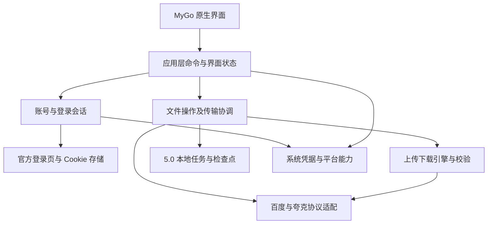

# Ferry Drive 5.0 技术方案

方案已完成文档 Review，实施待启动，输入为 [5.0 产品方案](product-proposal.md)。采用 Go + MyGo 原生 `ui` 包实现一套跨平台桌面应用，按当前 Swift 业务规则迁移网盘协议、传输引擎和界面状态。官方网页登录沿用现有业务流程，由两端系统网页引擎承载。

## 1. 当前事实与技术约束

当前基准提交为 `449de5a5faf78f2fa8753d99877e84b12235f0fa`，对应 4.2.0。SwiftUI 与 AppKit 负责界面，文件列表使用 `NSOutlineView`。`FerryKit` 已分为 `BaiduKit`、`QuarkKit`、`DownloadKit` 与 `FerryCore`，可按现有职责迁移至 Go。

| 当前实现 | 迁移中保留的职责 |
| --- | --- |
| `AppModel`、`WorkspaceState`、`DirectoryBrowserState` | 应用装配、账号和服务关联、导航、每家网盘独立目录状态、异步请求有效性 |
| `NetdiskOutlineView`、`FileTree` | 树形列表、列模型、同一选择集合、父子去重、行内编辑、准确拖放目标 |
| `WebLoginSession`、两家 Credential 类型、`QuarkAccountSession` | 官方登录会话、Cookie 提取和账号校验、凭据恢复及失效处理 |
| `BaiduKit`、`QuarkKit` | 目录、分享、上传下载协议、签名、请求头、重定向和网盘错误转换 |
| `DownloadEngine`、`JobCoordinator` | 分片下载、持久化、队列、暂停恢复、链接刷新、任务和账号绑定 |
| `UploadCoordinator`、`UploadEngine`、`UploadDestination` | 扫描、上传会话、分片回执、提交意图、内容回读、发布及失败恢复 |
| `JobStore`、`UploadStore`、`IntegrityService` | 任务、清单和检查点持久化、内容校验依据 |
| `DirectUploadPresenter`、`TransferLifecycle`、`AppDelegate` | 文件选择和入队上下文、系统生命周期与退出收尾 |

现有 Swift 的 `Darwin`、`CryptoKit`、Keychain、目录书签和系统代理调用需要用 Go 或平台接口替代。现有协议和测试作为行为依据，Go 的并发、文件及网络实现需要独立验证。

已验证的环境为 Go 1.27.3、MyGo CLI 0.8.3 和 NSIS 3.13。临时原生示例通过测试，并在本机生成 macOS arm64 与 Windows x64 安装产物。该证据覆盖工具链，Ferry Drive 的业务及 Windows 实机表现尚待实现和验收。

## 2. 总体架构与模块职责

MyGo 主窗口通过 `WindowOptions.Content` 挂载 `ui.View`。文件、传输、设置、账号操作和业务弹窗均由 `ui` 组件组成，原生界面直接调用 Go 应用层命令。网络和文件工作在后台执行，结果通过 MyGo 主线程调度更新视图状态。[MyGo 原生 UI](https://mygo.egoist.dev/docs/ui) · [视图与线程](https://mygo.egoist.dev/docs/ui/views)



拟在仓库内新增 `desktop/` 作为 Go 模块。迁移期间以固定 Swift 提交作对照，验收完成后再处理已替代入口。

```text
desktop/
  main.go                 应用启动与装配
  go.mod / go.sum          固定框架及依赖
  mygo.json               5.0 应用身份、资源与构建目标
  internal/app/           账号、导航、目录状态与操作编排
  internal/ui/            主窗口、文件、传输、详情、设置与业务弹窗
  internal/baidu/         百度协议
  internal/quark/         夸克协议
  internal/download/      通用下载引擎
  internal/core/          文件管理、上传、任务协调与完整性检查
  internal/store/         5.0 设置、任务、清单与检查点
  internal/platform/      系统选择器、凭据、代理、文件及生命周期适配
  resources/              图标与应用资源
```

目录按现有职责落地，具体文件在实现相应功能时创建。共享业务只依赖实际使用的平台接口，平台差异集中在对应实现中。

### 状态所有权

| 状态 | 唯一所有者 | 访问方式 |
| --- | --- | --- |
| 当前页面、网盘范围、方向和状态筛选 | 应用工作区状态 | UI 命令修改，列表和统计派生 |
| 目录、路径、展开、搜索、排序、勾选、焦点、编辑对象 | 每家网盘的目录状态 | 主线程更新，以稳定远端引用恢复对象 |
| 凭据、账号身份、客户端会话代次 | 账号会话 | 操作携带账号和会话代次，提交前再验证 |
| 任务阶段、队列、用户暂停意图、检查点 | 上传／下载协调器 | 单一协调入口串行应用状态变更，后台 worker 回报结果 |
| 详情、按钮启用、汇总及用户状态文案 | 由任务快照派生 | UI 读取不可变快照 |
| 持久化数据 | 对应 Store | 协调器确认保存结果后推进需持久化的状态 |

为 UI 元素使用任务 ID、网盘与远端对象引用等稳定键。目录异步结果带请求代次，切换目录或账号后丢弃过期结果。后台进度合并刷新，阶段变更、失败和完成及时送达。视图构建函数只构建界面和消费交互，网络和文件副作用由命令入口发起。

## 3. 功能技术映射

| 编号 | 产品功能 | 模块及数据／接口 | 异常边界与验证点 |
| --- | --- | --- | --- |
| F-01 | 主窗口与导航 | `ui` 分栏与工具栏，`app` 工作区偏好；菜单与快捷键调用同一命令 | 窄窗、详情开关、重启恢复、当前网盘与分类高亮逐项对照 |
| F-02 | 网盘账号与登录 | 登录窗口、临时 Session、Cookie 读取、两家账号 API、凭据 Store | 关闭登录清理监听；校验失败保留现有恢复路径；实际扫码、Cookie 补充登录、退出重开 |
| F-03 | 文件浏览与选择 | `ui.OutlineTable`、稳定远端引用、每家目录状态和 FileTree 等价规则 | 异步展开、请求过期、多选与勾选一致、排序后选择及滚动稳定 |
| F-04 | 文件管理 | 账号与目录上下文、创建／重命名／移入回收站 API | 冻结操作目标，输入法组合输入、重复提交、同名失败及部分成功均有准确结果 |
| F-05 | 本地上传 | 系统选择器、拖放、上传协调器、分片会话与回执、SHA-256 回读 | 混合选择、准确投放、源文件变化、暂停恢复、响应丢失、同名保留两份 |
| F-06 | 文件及分享下载 | 分享解析、转存规划、Range 下载、目标文件与检查点、内容校验 | 提取码失败、链接失效、Range 异常、重定向、磁盘错误、重复启动后的续传 |
| F-07 | 传输列表与详情 | 共用任务展示模型、可见集合、任务操作能力、分页清单 | 批量命令只作用于允许操作的可见对象；部分失败重试、定位和重选源文件 |
| F-08 | 设置与反馈 | 设置模型、限速预算、并发限制、代理配置与账号反馈 | 默认值／边界与现有代码对照，代理失败、目录不可用及保存失败准确反馈 |
| F-09 | 桌面集成与安装 | 平台能力、生命周期、应用身份、MyGo 构建与 NSIS | 安装后启动、真实系统通知、文件定位、休眠退出及重启恢复；两端实机记录 |

## 4. 原生界面迁移

### 4.1 页面与组件

主窗口装配侧边栏、文件工作区或传输工作区，以及右侧详情。文件工作区保留工具栏、路径栏、树形表格和底部数量；传输工作区保留方向切换、筛选列表、汇总和详情。设置使用独立原生窗口，业务输入及确认使用 MyGo 原生弹窗。

优先使用 `OutlineTable`、List、EditableText、SplitView 等现成能力，集中管理当前项目的颜色、字号、间距、列宽和图标映射。组件实际 API 以固定版本源码为准。`OutlineTable` 提供树形列和按需构建，排序、列宽调整及列移动具备框架支持。产品只暴露当前基准需要的交互。[MyGo Outline](https://mygo.egoist.dev/docs/ui/outline)

文件选择集合由目录状态统一维护，行高亮和勾选都是该集合的展示。焦点单独表示键盘当前位置。分享选择树复用相同的层级和选择规则，保留其自身业务上下文。右键操作绑定当前命令实际作用的对象，异步编辑期间通过对象引用保持目标。

新建沿用“选择可用默认名 → 创建 → 依据回执插入列表 → 聚焦并全选名称 → 行内重命名”。Enter 或失焦按当前规则提交，Esc 保留已创建目录，中文输入法确认候选时不触发业务提交。名称校验沿用两家网盘实际限制。

### 4.2 对照与平台适配

从基准应用记录实际窗口尺寸、分栏范围、行高、字号、列宽、弹窗宽度和各状态截图，将必要数值转为 UI 常量。按相同逻辑窗口尺寸比较，Windows 另覆盖 100%、150%、200% 缩放与跨屏焦点。当前代码与历史设计冲突时采用当前代码，并保留差异说明。

macOS 图标按现有语义呈现；Windows 采用可跨平台分发、外观匹配的图标资源，分别核对资源许可。快捷键通过平台命令映射生成，命令启用条件来自同一业务能力判断。主操作、列含义和信息顺序保持产品方案定义。

### 4.3 HIG 与前端开发 Skill 的适用范围

`hig-product-experience` 指导 Ferry Drive 自有页面、UI 和交互的体验设计及验收。macOS 应用其中的 Mac 平台规则，Windows 沿用产品的信息层级、实色视觉与反馈原则，快捷键、系统对话框和辅助功能遵循 Windows 桌面习惯。官方登录页由网盘服务方提供，应用自有的登录入口和失败反馈按本节验收。

`frontend-development` 指导页面职责、组件复用、状态归属和数据边界。Go + MyGo 使用原生视图、事件处理和主线程调度落实这些通用规则。React、TypeScript 和 Web 专属条款仅适用于其对应技术栈。

| 规范 | Go + MyGo 实现要求 | 验收依据 |
| --- | --- | --- |
| HIG · 页面与信息 | 按当前任务组织导航、文件与传输工作区、右侧详情和独立设置窗口。保持当前网盘、目录或任务上下文清晰，窄窗优先保留主要操作与搜索入口。 | T17 对照 T01 基线，检查页面切换、详情与窄窗可达性（C14、C48、C63、C64）。 |
| HIG · 视觉与平台 | 共享主题管理语义颜色、字号、间距和选中样式。应用绘制的内容、侧栏、工具栏和弹窗使用不透明实色表面，通过字重、间距和分隔线表达层级。 | 对照同数据、同逻辑窗口尺寸下的浅深色、可读性、对齐与交互状态（C63）。Windows 缩放与跨屏检查归第二阶段（C05）。 |
| HIG · 操作与反馈 | 操作前明确对象和影响范围。加载、空态、字段错误、部分失败和恢复入口出现在对应区域。保持可见焦点、中文输入、平台快捷键与辅助功能语义。 | 原生窗口验证右键作用范围、加载重试、组合输入、键盘及读屏（C21、C23、C25、C64、C65）。 |
| 前端开发 · 组件与状态 | `internal/ui` 装配界面、接收展示数据和操作回调；`internal/app` 协调业务命令。按第 2 节指定状态所有者，在最小有效范围保存状态。选择计数、按钮可用性与任务摘要从同一状态或快照派生。共享组件按实际调用方和业务语义复用。 | 代码审查核对组件依赖、状态唯一来源和共享调用方；验证勾选与高亮、有效选择恢复、批量操作范围及详情同步（C18、C20、C46、C48）。 |
| 前端开发 · 事件与异步数据 | 用户操作由事件调用命令入口。视图读取状态并派生展示，后台执行网络及文件操作，再将有效结果调度回 UI 主线程。请求发起、取消、过期结果判断和清理由同一处管理。 | MyGo 无窗口测试验证状态和命令，实际 App 检查切换目录或账号时迟到结果的处理，以及失败后的反馈与恢复（C15、C23、C47）。 |

新页面和重要流程编码前，按对应任务明确用户操作、组件层级、状态所有者、命令与数据流，以及实际需要复用或新增的文件。T17 按第 8 节分阶段验收。第一阶段在 Mac 检查适用场景，第二阶段补齐 Windows 运行证据。

## 5. 网盘登录与凭据

沿用 `WebLoginSession` 的完整流程。每次登录创建独立临时会话，加载当前官方 URL，网页自行完成扫码、短信和安全验证。监听导航并按现有轮询规则读取 Cookie，使用对应凭据解析和账号 API 校验，校验成功后保存并安装业务客户端。登录窗口关闭时撤销监听、轮询和待完成回调。

保留百度 BDUSS／STOKEN 提取、缺失时的提示和 Cookie 手动登录入口。夸克保留其独立凭据判断、账号恢复、失效及重新登录规则。两家的差异按当前实现迁移。迟到的登录回调按会话代次拒绝，任务持续绑定原账号身份。

网页登录沿用 `WebLoginView.swift` 的代理边界，始终使用系统代理。应用设置中的自定义 SOCKS5 用于业务客户端、传输及校验回读，Cookie 提取后的账号 API 校验也走业务客户端配置。

使用 MyGo 临时 Session 和 Cookie API。macOS 为 WKWebView，Windows 为 WebView2。官方登录页只承担登录，业务客户端在 Go 内发起请求。公开文档提供临时会话及 HttpOnly Cookie 读取能力，两家真实登录的成功条件仍需实测。[MyGo Session 与 Cookie](https://mygo.egoist.dev/docs/app#sessions)

凭据、代理密码和敏感上传恢复信息使用系统凭据存储。MyGo Secrets 单值上限为 2560 字节，完整 Cookie 或凭据 JSON 可能超过该限制。建议统一将密钥保存在 Secrets，用该密钥加密本地凭据文件，写入采用原子替换；日志只记录必要的 Cookie 名称与域，不记录值。退出成功清除对应持久凭据，上传恢复信息按任务生命周期清理。[MyGo Secrets](https://mygo.egoist.dev/docs/native#secrets)

## 6. 网盘协议与传输一致性

### 6.1 协议层

按现有 Endpoint、签名、Cookie、User-Agent、请求头、分页、时间字段和错误分类逐项迁移。百度与夸克各自维护客户端及上传授权。使用 Go `net/http` 和标准编码、摘要能力，明确配置代理、超时和重定向行为。用当前请求／响应样本及测试验证，特别核对 Go 与 URLSession 的默认差异。

接口以现有 `Netdisk`、`DownloadSource`、`UploadDestination` 职责为边界，输入包含账号与远端引用，输出包含准确对象及可恢复的业务错误。服务端错误、登录失效、取消和网络失败保持不同语义，UI 按现有位置反馈。

### 6.2 上传与下载

- 上传入口冻结账号、会话和目标目录，系统选择器确认后再次验证。目录扫描、任务落盘、同名保留两份、分片、合并、回读校验和完成发布沿用当前顺序。
- 分片成功以服务端确认和本地回执保存为依据。重试发送同一份已核对数据，逻辑完成字节与实际网络字节分别统计，限速覆盖重试流量。
- 合并、创建目录等有远端副作用的步骤先保存意图。响应丢失时保留待核对状态，恢复后先查询远端结果，确认后继续。
- 下载保留 Range 校验、重定向后的必要请求头、链接刷新、随机写入和检查点。磁盘内容及检查点一致后才允许重启续传。
- 下载最终文件沿用现有 `moveItem(_:toAvailable:)` 的原子保留两份规则，重名采用 `name (1).ext` 等候选名。Windows 适配需在移动时原子拒绝覆盖，两个并发下载完成到同一目标时分别落到独立文件，并将实际路径写回任务。
- 用户暂停与休眠等运行阻断分开记录。取消 worker 后等待收尾屏障，随后才允许同一任务恢复，防止旧 worker 与新 worker 同时写文件或提交。
- 上传的完成阶段包含当前要求的完整内容回读。下载保留已有校验依据和匹配规则。校验失败、部分成功、待核对与最终完成分别进入对应状态。
- 保留当前可达的重复任务判断、失败项重试、源文件重选、远端核对及临时转存清理行为，以现有状态与操作能力测试核对。
- 上传优先级只影响尚未执行的批次，并持久化优先顺序。取消上传先保存取消意图、停止并等待 worker，在途提交的未决结果保留并阻止移除记录；允许按已有记录核对远端，已成功云端内容保留。

### 6.3 5.0 本地数据

采用独立 5.0 数据命名空间，首次启动按新安装初始化。设置、任务摘要、逐文件清单、上传会话回执、下载检查点及校验依据延续现有文件持久化职责，用版本化 JSON 结构实现。大批次清单保持分页读取。

单记录写入通过同目录临时文件、刷新和平台可靠替换完成。跨文件步骤通过意图与回执关联恢复。写盘失败交给协调器处理，避免内存显示已保存或已完成。启动恢复按落盘状态核对未完成的副作用，重复打开进程时确保同一数据目录只有一个任务执行者。

账号绑定、暂停意图、完成回执、失败原因和本地源引用由各自拥有者保存。UI 展示状态由这些事实计算，恢复后继续沿用用户可见的状态与动作。

## 7. 平台适配重点

| 能力 | 技术处理 | 具体验证 |
| --- | --- | --- |
| 文件和文件夹混合选择 | 当前 `NSOpenPanel` 同时支持两者；MyGo 0.8.3 的 `OpenDialogOptions.Directory` 将文件与目录选择分开。需要补齐平台选择器适配，实际证明与产品基准等价。 | 两端单次多选文件、目录及混合项，取消与目标账号变化；差异未解决时标记该项未验收 |
| 目录授权和文件引用 | macOS 实现目录书签与访问生命周期，Windows 保存本地路径并重新检查可访问性。 | 重启后恢复目录、源文件移动、权限变化和重新选择 |
| 路径和文件操作 | 本地路径使用 `filepath`，远端引用沿用网盘格式；平台层处理安全落盘与回收站。 | Windows 保留名称、非法字符、大小写冲突、长路径及被占用文件；逐项错误可处理，文件不越出目标目录 |
| 系统代理与 SOCKS5 | 官方登录网页随系统代理，业务 HTTP 按系统或自定义 SOCKS5 设置运行；修改业务代理通过串行收尾和会话替换，只应用最后一次有效配置。 | 网页及业务请求的实际出口分别检查，覆盖认证失败与活跃传输中连续切换；待旧 worker 收尾后恢复，已发出的普通 API 请求按原客户端完成 |
| 生命周期 | 接入 MyGo 系统事件，复用当前 `TransferLifecycle` 的业务语义和退出屏障；用 `Power.KeepAwake` 等价迁移 `DownloadActivity`，实际上传、下载及回读共用一个防闲置休眠声明。 | 活跃传输时退出、休眠恢复、用户暂停后唤醒；实际执行时持有活动，全部停止和退出释放，重复状态不重复持有 |
| 通知和本地定位 | 使用 MyGo 对应能力，补齐平台缺口，通知沿用当前后台提醒规则。 | 点击定位准确选中文件、通知授权、前后台切换及任务结果 |

框架公开提供选择器、系统凭据、剪贴板、通知和电源事件。具体接口覆盖程度以固定版本源码和两端运行结果核对。[MyGo 桌面 API](https://mygo.egoist.dev/docs/native)

Windows 本地下载遇到设备保留名、禁止字符或尾随点／空格等无法按原名称创建的项目时，标记该文件失败并给出名称原因，保留其他文件结果；不静默改名。实际文件系统将两个名称判为同名时，采用下载原子保留两份规则。长路径通过支持的系统路径调用处理，超过实际限制时按具体文件报错。远端相对路径校验拒绝绝对路径、盘符、UNC 前缀和父级逃逸，并核对实际落盘路径没有通过符号链接或目录联接跳出选定目录。

## 8. 构建、安装与验证

`go.mod` 和 `go.sum` 固定 MyGo 0.8.3 及实际依赖，使用已安装的 Go 1.27.3。项目内用固定版本 CLI 构建。构建目标为 `darwin/arm64` 与 `windows/amd64`，应用身份和 5.0 数据目录在配置中固定。

macOS 交付签名的 `.app`，Windows 交付 NSIS 安装包和 SHA-256 校验文件。安装过程检查 Windows 登录所需 WebView2 Runtime，缺失时引导安装官方运行时。代码签名按已有可用身份处理，并记录实际签名和公证状态。[MyGo 分发](https://mygo.egoist.dev/docs/distribution)

在装有 Go 和 NSIS（`makensis`）的 Mac 上，从仓库根目录运行：

```sh
Scripts/build-v5.sh
```

脚本在 `.build/ferry-drive/darwin-arm64/` 生成并校验 `Ferry Drive.app` 的签名，在 `.build/ferry-drive/windows-amd64/` 生成 x64 安装包及 SHA-256 校验文件。默认使用 macOS 临时签名供本机验收。设置 `FERRY_CODESIGN_IDENTITY` 可选用本机已有的签名身份。公证状态单独记录。

Mac 安装时将 `Ferry Drive.app` 拷贝到 Applications，再从 Applications 启动。Windows 运行 `ferry-drive-setup-5.0.0-amd64.exe` 安装，登录前按应用提示安装 x64 WebView2 Evergreen Runtime。离线环境使用微软提供的 x64 独立安装程序。首次启动使用独立的 5.0 配置目录。

Windows 10 与 Windows 11 使用同一 x64 构建。系统 API 使用前核对最低版本，较新窗口样式等可选能力做可用性检测，核心路径在 Windows 10 实际运行。Go 官方最低要求包含 Windows 10，MyGo 文档列出 Windows 10/11 的原生渲染支持，兼容性还须核对所选依赖和实际 API。[Go 系统要求](https://go.dev/wiki/MinimumRequirements) · [MyGo 平台要求](https://github.com/egoist/mygo/blob/v0.8.3/docs/README.md)

安装和打开官方登录页前检测 WebView2 Runtime。缺失时原生主界面可以启动，登录入口显示运行时安装指引；安装完成后重新检测并允许重试。采用 Microsoft Evergreen Runtime，覆盖安装失败、取消、离线和仅安装 Edge 浏览器的情况。[Microsoft WebView2 分发](https://learn.microsoft.com/microsoft-edge/webview2/concepts/distribution)

验收按功能完整性和平台阶段组织。第一阶段在 Mac 完成 F-01 至 F-09 的适用运行用例，并在 Mac 交叉编译 Windows 目标、生成 NSIS 安装包。第二阶段具备 Windows 环境后补齐 Windows 10/11 的实际运行用例。Windows 运行待验证不阻塞第一阶段，交叉编译结果仅证明构建可用。

| 验证层面 | 方式与完成证据 |
| --- | --- |
| 静态与构建 | `go vet`、对应模块测试、两端编译及安装产物检查 |
| 业务迁移 | 复用现有 Swift 测试中的输入、结果和错误边界建立 Go 对照，覆盖账号、分享、协议、任务状态、范围、并发和校验 |
| 一致性与并发 | 测试取消／恢复屏障、分片回执、写盘失败、远端响应丢失、重启恢复；在支持环境执行 race 检测 |
| 原生 UI | MyGo 无窗口测试验证状态和命令；实际 App 验证布局、键盘、中文输入、多选、拖放及辅助功能 |
| 真网盘闭环 | 两家网盘分别执行文件与目录上传下载、分享、校验、暂停继续、部分失败及恢复，回读核对结果 |
| 分阶段安装 | 第一阶段在 macOS 14+ 安装、登录、传输、重启；第二阶段在 Windows 10 1809／22H2 及 Windows 11 x64 验证对应流程；分别记录系统、架构和安装包哈希 |
| 资源表现 | 使用相同任务和目录样本记录启动、空闲、列表、传输期间 CPU、内存和交互表现；记录稳定空闲的主进程 RSS。另记物理占用及峰值，活跃传输结束后复查回落 |

当前尚未执行 5.0 业务迁移、视觉对照及 Windows 实机验收。Windows 10 是目标交付平台，最低构建假设继承产品方案，T02 第一阶段进行构建检查，第二阶段进行 Windows 运行验证。实现安排和逐项验收分别见 [任务清单](tasks.md) 与 [测试用例](test-cases.md)。

## 9. 四份文档 Review 记录

2026-11-10 对产品方案、技术方案、任务清单和测试用例按需求正确性、实现一致性、系统层面组织三个只读子代理审查，主代理对照当前源码复核并修订。项目没有审查忽略条目。

| 级别 | 已确认问题 | 修订与验证位置 |
| --- | --- | --- |
| P2 | Windows 本地名称与冲突处理缺少明确预期 | 产品平台规则、技术第 6～7 节及 C40 明确非法名称逐项失败、同名原子保留两份、实际路径和长路径处理 |
| P2 | 下载用例引用当前 UI 不存在的完成后手动校验 | C41 改为自动校验节点注入不一致，使用现有失败重试入口 |
| P2 | 基础任务依赖与端到端测试存在循环 | 任务第 1～2 节区分实现完成与集成验收通过，基础模块测试解除开发依赖，后续入口联合验收 |
| P2 | 优先上传、取消上传的实际操作未明确覆盖 | 产品功能补充、上传技术规则、T10／T13 和 C67／C68 覆盖排序、取消意图、在途提交核对及移除限制 |
| P2 | 防闲置休眠行为遗漏 | 生命周期技术规则、T15 和 C69 覆盖真实 worker 活跃、释放及重复通知 |
| P2 | 登录网页与自定义 SOCKS5 边界不明确 | 登录技术规则及 C53 明确系统代理与业务代理分工，连续切换验证最终配置和串行收尾 |

三个审查代理已复核对应修订，6 类问题均已关闭，未发现新的阻断性文档问题。文档本地链接、用例编号和任务依赖检查通过，18 项任务依赖无循环，69 组用例编号连续且无重复。

以上结论属于文档审查及源码对照。Windows 10 1809 是最低构建实施假设，混合选择器适配、真实网盘登录和两端运行结果保留为对应任务的实际验收门槛。

后续范围调整于 2026-11-10 按用户要求同步到四份文档。第一阶段仅执行 Mac 运行验收，Windows 的构建检查在 Mac 上完成，运行验收归第二阶段。T02、T16、T18、阶段门槛及用例执行规则已同步调整，前述 Windows 验收门槛适用于第二阶段。

### Ferry Drive 更新发布

Go 应用通过 MyGo 的更新模块按平台读取 GitHub Release 清单，使用内置 Ed25519 公钥验证更新归档。macOS 和 Windows 都使用原生更新界面。自动检查可在设置关闭，安装须经确认。正在传输时保留下载好的更新，完成后从「检查更新…」重启。重启前复用传输保存屏障并释放 5.0 数据目录锁。

发布版本以 `desktop/mygo.json` 为准，并在 `CHANGELOG.md` 写入对应版本。发布机提供与 `updates.publicKey` 配对的 `MYGO_UPDATER_PRIVATE_KEY`，私钥保存在受保护的发布环境中。本地签名构建用 `bash Scripts/build-v5.sh`。发布前从干净的工作区构建，创建并推送指向该构建提交的 `drive-v<版本>` 标签。随后在 `desktop/` 使用以下命令生成两端产物并上传草稿：

```sh
go tool mygo build -platform darwin/arm64,windows/amd64 -skip-dmg -sign "$FERRY_CODESIGN_IDENTITY" -upload
```

核对草稿包含两端 `update-*.json`、对应签名归档及 Windows 安装器，再用 `gh release edit drive-v<版本> --draft=false --latest=false` 发布。GitHub Latest 继续用于旧版 Sparkle 渠道。macOS 初次安装可解压归档取得 `.app`。
